# 若依医疗管理系统 — 详细设计说明书

| 项目 | 内容 |
|------|------|
| 文档名称 | 若依医疗管理系统 详细设计说明书 |
| 项目名称 | 若依医疗管理系统（RuoYi-Medical） |
| 当前版本 | V1.0 |
| 文档状态 | 正式版（可指导编码与测试） |
| 编写日期 | 2026-10-08 |
| 文档拟稿 | 张翔 |
| 适用对象 | 开发 / 测试 / 评审 / 答辩 |
| 上游文档 | 《项目需求文档》v1.0（3.1–3.14 功能需求、AC-01–AC-16 验收标准） |
| 代码基线 | Git HEAD `a7091d7` + 工作区未提交改动（截至 2026-10-08） |
| 文档页数 | 详见文末目录与附录 A |

### 更新记录

| 版本 | 日期 | 修订人 | 修订内容 | 影响章节 |
|------|------|--------|----------|----------|
| V0.1 | 2026-09-15 | 张翔 | 建立骨架，完成数据库与模块划分 | 3、4 |
| V0.5 | 2026-09-19 | 张翔 | 补充业务闭环与 AI 模块接口定义 | 5、6 |
| V1.0 | 2026-10-08 | 张翔 | 全量对齐代码与需求文档；补架构决策依据、异常与降级、性能与安全规范；修正 `medical_chest_xray` 三分类表结构 | 全部 |
| V1.1 | 2026-10-08 | 张翔 | 落实缺陷修复：胸片三分类迁移（`patch_v4`）、诊疗 ID 原子分配（`medical_id_allocator` + `patch_v5`）、401/导出/校验异常三项修复、统计缓存与测试编译修复；补列一致性门禁 | 4.4.15、4.4.17、4.6、6.5、10.4、附录 A/B |

### 审核记录

| 审核角色 | 审核人 | 审核日期 | 审核结论 | 主要意见 |
|----------|--------|----------|----------|----------|
| 技术负责人 | 待填写 | 待填写 | 待填写 | 重点关注 4.6 迁移策略与附录 B 已知缺陷 |
| 测试负责人 | 待填写 | 待填写 | 待填写 | 重点关注第 12 章用例与 AC 映射 |

---

## 0 文档说明

### 0.1 编写目的

本说明书在《项目需求文档》v1.0 与概要设计的基础上，对系统的**架构分层、模块划分、接口契约、数据库结构、业务流程、异常处理、开发约束、性能指标与安全规范**作出实现层面的规定，使开发人员可据此直接编码、测试人员可据此直接编写用例。

本说明书同时承担**双向追溯**职责：

- **正向**：需求编号（FR-3.x）→ 本说明书设计章节 → 代码位置（文件 + 类/方法）→ 验收项（AC-xx）。
- **反向**：任一代码文件可在附录 A 反查其对应的需求来源与验收标准。

### 0.2 适用范围与读者

| 读者 | 关注章节 |
|------|----------|
| 后端开发 | 2（架构）、3（模块与类）、4（数据库）、5（接口）、6（详细实现）、8（异常）、9（约束）、11（安全） |
| 前端开发 | 2.3（部署与代理）、5.3（API）、6（页面原型逻辑）、7（流程与时序） |
| AI 服务开发 | 2.2、5.3.6（AI 契约）、6.14、8.4（降级） |
| 测试 | 5.2（错误码）、7（流程与状态流转）、12（用例）、附录 A（追溯矩阵） |
| 评审 / 答辩 | 2.2（选型决策）、4.3（ER）、7（流程图）、10（性能） |

### 0.3 术语表

统一术语，避免文档与代码、前后端之间出现同义异名。

| 术语 | 英文 / 缩写 | 定义 | 代码对应 |
|------|-------------|------|----------|
| 号源 | Quota | 某排班（科室+医生+日期+时段）可挂号的总额度，含总数与已用数 | `medical_schedule.total_num` / `used_num` |
| 挂号单 | Registration | 患者挂号的业务单据，单号前缀 `GH` | `medical_registration.reg_no` |
| 处方单 | Prescription | 医生开具的用药单据，单号前缀 `CF` | `medical_prescription.prescription_no` |
| 诊疗记录 | Diagnosis | 一次就诊的主诉、诊断、方案与费用记录 | `medical_diagnosis` |
| 发药流水 | Dispensing | 一次实际发药动作的记录，退药以 status 标记而非删除 | `medical_dispensing` |
| 部分发药 | Partial Dispensing | 处方明细未全部发完的中间状态 | `prescription_status = '1'` |
| 效期 | Expiry Date | 药品有效期截止日；`expiry_date < CURRENT_DATE` 即禁止发出 | `medical_drug.expiry_date` |
| 近效期 | Near Expiry | 距效期 ≤ 90 天的预警状态（仅提示，不拦截） | 前端计算 `daysLeft` |
| 过敏冲突 | Allergy Conflict | 患者过敏史关键词命中处方药品，产生警示（**警示不拦截**，见 6.8） | `AllergyChecker.check()` |
| 审计留痕 | Audit Log | 开方/发药/退药/退号四类动作写入的操作记录，只读 | `medical_audit_log` |
| 降级 | Degradation | AI 依赖不可用时的替代输出路径（模板 / 仅检索 / 拒答） | `fallback.py`、`rag.py` |
| 拒答 | Abstention | RAG 检索未过相似度阈值时不调用大模型，返回固定话术 | `RAG_SIM_THRESHOLD = 0.55` |
| 裁剪版 | Trimmed Edition | 相对官方 RuoYi 移除数据权限、操作日志、按钮级鉴权、动态路由后的版本 | 见 2.2 |
| 真相源 | Source of Truth | 某元数据（如模型特征顺序）的唯一权威出处 | `models/risk_features.json` |

### 0.4 参考资料

| 编号 | 文档 / 标准 |
|------|-------------|
| REF-01 | 《若依医疗管理系统 — 项目需求文档》v1.0（`doc/项目需求文档.md`） |
| REF-02 | 《若依医疗 — 接口文档》（`doc/接口文档.md`） |
| REF-03 | 《若依医疗 — 部署说明》（`doc/部署说明.md`） |
| REF-04 | 《若依医疗 — AI 模块部署说明》（`doc/AI模块部署说明.md`） |
| REF-05 | 《若依医疗 — 测试记录》（`doc/测试记录.md`） |
| REF-06 | 《若依医疗 — 运行演示流程与检查清单》（`doc/运行演示流程与检查清单.html`） |
| REF-07 | 国家标准 GB/T 9385-1988《计算机软件需求说明编制指南》 |
| REF-08 | 国家标准 GB/T 8567-2006《计算机软件文档编制规范》 |
| REF-09 | 国家卫生计生委《电子病历应用管理规范（试行）》（国卫办医发〔2017〕8 号） |
| REF-10 | 国家卫生计生委《医疗机构病历管理规定（2013 年版）》（国卫医发〔2013〕31 号） |
| REF-11 | 国家标准 GB/T 22239-2019《信息安全技术 网络安全等级保护基本要求》 |
| REF-12 | Bai et al. *Qwen Technical Report*, 2023（通义千问 Qwen2.5 系列大模型技术报告） |
| REF-13 | Zeng et al. *ChatGLM: Open Multilingual Dialogue Language Models*, 2022（智谱 ChatGLM / GLM 系列） |
| REF-14 | Johnson et al. *MIMIC-CXR: A large publicly available database of labeled chest radiographs*, 2019（胸片影像基准数据集） |
| REF-15 | Lewis et al. *Retrieval-Augmented Generation for Knowledge-Intensive NLP Tasks*, NeurIPS 2020（RAG 检索增强生成原著） |

### 0.5 需求追溯矩阵（总表）

> 完整矩阵（含代码位置）见**附录 A**。此处给出模块级索引。

| 需求编号 | 需求名称 | 设计章节 | 验收项 |
|----------|----------|----------|--------|
| FR-3.1 | 认证与登录 | 6.1 | AC-01 |
| FR-3.2 | 患者管理 | 6.2 | AC-02 |
| FR-3.3 | 挂号管理 | 6.4 | AC-03、AC-04 |
| FR-3.4 | 诊疗管理 | 6.5 | AC-08 |
| FR-3.5 | 药品管理 | 6.6 | AC-10 |
| FR-3.6 | 处方与发药 | 6.8 | AC-05、AC-06、AC-07 |
| FR-3.7 | 随访管理 | 6.9 | AC-17 |
| FR-3.8 | 站内信 | 6.10 | AC-18 |
| FR-3.9 | 价目管理 | 6.7 | AC-19 |
| FR-3.10 | 排班管理 | 6.3 | AC-09 |
| FR-3.11 | 审计日志 | 6.11 | AC-16 |
| FR-3.12 | 统计看板 | 6.12 | AC-15 |
| FR-3.13 | 定时任务 | 6.13 | AC-20 |
| FR-3.14 | AI 智能模块 | 6.14 | AC-11 ~ AC-14 |

---

## 1 引言

### 1.1 编写目的

见 0.1 节。本说明书面向实现，凡需求文档中"做什么"的表述，在此处一律落实为"由哪个类、哪张表、哪条 SQL、哪个接口完成"。

### 1.2 背景

面向中小型医疗机构，构建覆盖"患者就诊—医生诊疗—药房发药—随访管理"全流程的轻量级医疗业务管理系统，并集成 AI 辅助能力。系统采用 B/S 结构，后端为 Spring Boot（基于 RuoYi 裁剪），前端为 Vue2 + Element UI，AI 能力由独立的 Python FastAPI 微服务承载，通过 HTTP 与后端单向耦合。

相对于官方 RuoYi，本项目做了**有目的的裁剪**（详见 2.2）：移除数据权限、操作日志、按钮级鉴权、动态路由、验证码等与门诊业务无关的通用能力，把复杂度集中投入到业务闭环与 AI 集成上。

### 1.3 系统整体 E-R 图

本系统共存在 **16 个业务实体**，整体围绕"患者—挂号—诊疗—处方—发药"这条主干展开，排班提供号源约束，药品与价目提供计价与库存约束，AI 四表与审计表为主干的旁路记录。

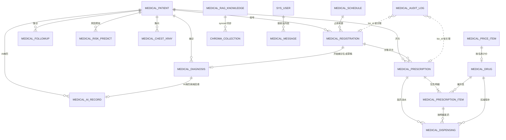

### 1.4 实体模型图

实体在数据库中的存储方式（主键、外键语义、关键属性）见 **第 4 章数据库设计** 4.4 节逐表说明。此处仅给出实体—模块归属：

| 实体 | 所属子系统 | 实体 | 所属子系统 |
|------|-----------|------|-----------|
| `medical_patient` | 患者管理 | `medical_dispensing` | 处方发药 |
| `medical_schedule` | 排班管理 | `medical_price_item` | 价目管理 |
| `medical_registration` | 挂号管理 | `medical_followup` | 随访管理 |
| `medical_diagnosis` | 诊疗管理 | `medical_message` | 站内信 |
| `medical_drug` | 药品管理 | `medical_audit_log` | 审计日志 |
| `medical_prescription` | 处方发药 | `medical_ai_record` | AI 病历 |
| `medical_prescription_item` | 处方发药 | `medical_risk_predict` | AI 风险 |
| `medical_chest_xray` | AI 胸片 | `medical_rag_knowledge` | AI 导诊知识 |

---

## 2 系统架构设计

### 1.5 系统创新点

本系统在"传统若依脚手架 + 医疗业务闭环 + 本地化 AI 集成"的组合下，形成了以下可评审的创新点，区别于简单的增删改查 demo。

**（一）业务建模创新——原子化的业务闭环**

- **零锁单库正确性**：占号源（`used_num+1 WHERE used_num<total_num`）、扣库存（`stock-1 WHERE stock>=qty`）、退药回滚三处核心正确性，全部由**单条条件原子 UPDATE + 影响行数判定**保证，无需 `SELECT FOR UPDATE` 行锁或分布式锁，在单机单库场景下把"判断与修改"压缩进一条 SQL，从根本上杜绝超卖与负库存（见 4.4.3、4.4.8 与 6.4、6.8）。
- **全链路可追溯**：开方 / 发药 / 退药 / 退号四类动作统一落入 `medical_audit_log`，与业务表通过 `biz_id` 软关联，形成"谁、在哪个单据、做了什么"的完整审计链（见 4.4.12、6.11）。
- **业务 ID 分配器**：针对 `medical_diagnosis` 主键的并发安全，设计独立的 `medical_id_allocator` 行锁串行化取号方案，语义仍为 `MAX(id)+1`（删除后 ID 可复用，满足 AC-08），既解决并发撞主键，又避免引入 UUID 导致的排序与可读性损失（见 4.4.17、6.5）。

**（二）架构与技术创新——可降级、可离线、可复现的 AI 集成**

- **四层 + 一旁路进程隔离**：Java（Spring Boot / JDK 8）与 Python（FastAPI / PyTorch / Chroma）因生态不兼容，采用独立进程 + HTTP 单向耦合，AI 侧可独立启停，且具备**三档降级**（模板草稿 / 仅检索 / 固定拒答），任一依赖（Ollama、模型文件）缺失都不影响主营业务（见 2.1、6.14、8.4）。
- **本地化 RAG 防幻觉**：Embedding 模型（`paraphrase-multilingual-MiniLM-L12-v2`）与向量库（Chroma 本地持久化）全部离线固化，运行时零外网请求；检索设置 `RAG_SIM_THRESHOLD=0.55` 相似度阈值，未过阈值即触发拒答，从机制上抑制跨主题编造（见 6.14.4、附录 A FR-3.14.4）。
- **胸片三分类少数类优化**：CNN 骨干采用 ResNet18，针对 COVID-19 少数类引入过采样（WeightedRandomSampler）+ 类别加权交叉熵，将 COVID-19 召回率从误判拉升至 1.000（筛查"宁枉勿纵"），整体 macro-F1 达 0.9428（见 4.4.15、6.14.3）。
- **判别式风险预测 + 受控错误注入范式**：疾病风险预测采用轻量判别式模型（而非端到端 LLM），特征顺序以 `models/risk_features.json` 为唯一真相源；评测沿用 KNOTICED（LREC-COLING 2024）的受控错误注入方法，使小样本下的错误识别可复现、可定量（见 4.4.14、6.14.2）。

**（三）工程治理创新——把"可维护性"做成可评审项**

- **真相源治理**：模型特征顺序、低库存阈值、近效期天数等易漂移的元数据，分别收敛到 `risk_features.json` 与 `MedicalProperties` 配置，消灭散落各处的魔法值（见 2.2 D-07、9.1）。
- **代码↔数据库列一致性门禁**：新增 `.workbuddy/verify_cols.py`，对 270 条列引用与 169 个实体字段做全量比对，join 列与计算别名在白名单登记，把"表与实体漂移"类缺陷（如 B-04）挡在提交前（见附录 B-23）。
- **一键演示与容器化双形态**：保留 `start.bat` 一键拉起（双击即跑，适配答辩现场），同时提供 Docker Compose 五服务编排（换机 / 上云成本低），两种形态共享同一套外部化配置（见 2.3、2.3.1）。


### 2.1 总体架构分层

系统采用**四层 + 一旁路**的分层结构，层间单向依赖（除一处历史遗留反向依赖，见 2.4）。

| 层次 | 职责 | 所在模块 | 约束 |
|------|------|----------|------|
| 表现层 | 页面渲染、表单校验、路由与状态流转 | `ruoyi-ui`（Vue2 + Element UI） | 不承载业务规则；校验规则与后端一致 |
| 接入层 | HTTP 端点、参数绑定、统一响应封装 | `ruoyi-admin/.../controller` | 不含业务逻辑；不使用 `BaseController` |
| 业务层 | 事务边界、状态机、领域校验、审计 | `ruoyi-system/.../service/impl` | 业务异常统一 `ServiceException` |
| 数据访问层 | MyBatis 接口 + XML，原子 SQL 在此 | `ruoyi-system/.../mapper` + resources/mapper | 并发正确性由 SQL 条件保证 |
| 基础设施层 | 安全、缓存、跨域、全局异常 | `ruoyi-framework`、`ruoyi-common` | 不含业务语义 |
| **旁路：AI 服务** | 模型推理、向量检索 | `ruoyi-ai`（独立进程） | 与 Java 仅 HTTP 耦合，可独立启停 |

分层调用规则：

1. Controller **不得**直接注入 Mapper（唯一例外：`MedicalAuditLogController` 直接注入 `MedicalAuditLogMapper`，因其为纯只读查询且无 Service 实现）。
2. Service **不得**感知 HTTP 语义（不得使用 `HttpServletRequest`、`AjaxResult`）。
3. Mapper XML **不得**出现业务判断；业务判断上移到 Service，原子性判断下沉到 SQL 的 `WHERE` 条件。

下图（系统分层架构图）展示四层 + 一旁路的分层结构与允许的调用方向，其中 `ruoyi-framework → ruoyi-system` 为 2.4 所述唯一历史遗留反向依赖：

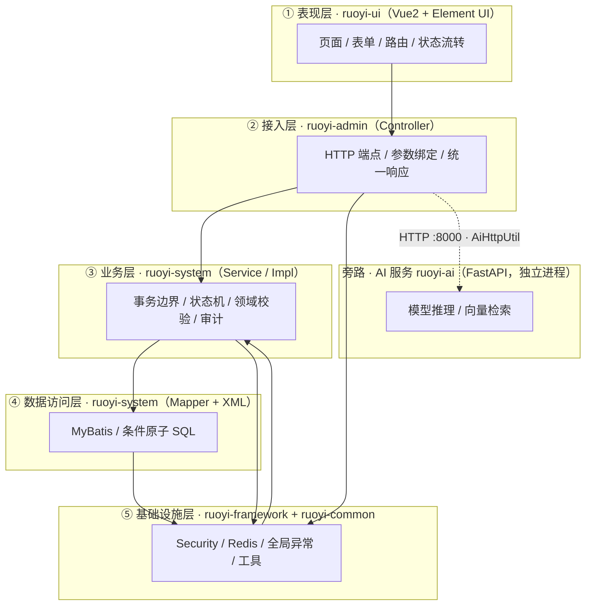

### 2.2 技术选型与决策依据

> 每项选型均给出**决策依据**与**备选方案取舍**，便于评审质询。

| # | 技术项 | 选型 | 决策依据 | 备选方案与取舍 |
|---|--------|------|----------|----------------|
| D-01 | 后端框架 | Spring Boot 2.7.18（RuoYi 裁剪） | 复用若依成熟的 Security + JWT + MyBatis 骨架，可把工期集中在业务闭环；JDK 8 兼容性与学校/演示环境一致 | **备选**：从零 Spring Boot（放弃）——需重写鉴权与分页，收益为"更干净的分层"，代价是至少两周工期，且失去与教学案例的可比性 |
| D-02 | ORM | MyBatis 2.3.2（XML） | 本系统的核心正确性来自**条件原子 UPDATE**（扣库存/占号源），需要手工控制 SQL；MyBatis 比 JPA 更直接 | **备选**：JPA/Hibernate（放弃）——乐观锁 `@Version` 也能防超卖，但需额外处理重试；且团队对 XML 调优更熟 |
| D-03 | 并发控制 | 条件原子 UPDATE + 影响行数判定 | 单条 SQL 完成"判断+修改"，无需 `SELECT FOR UPDATE` 行锁，也无需分布式锁；在单机单库场景下是最经济且最不易出错的方案 | **备选 A**：悲观锁 `SELECT ... FOR UPDATE`（放弃）——锁持有时间跨越网络往返，吞吐差；**备选 B**：Redis 分布式锁（放弃）——引入新的故障域，且本项目为单实例部署 |
| D-04 | 缓存 | Redis（仅会话）+ JVM 静态 Map（统计） | token 必须跨请求共享 → Redis；统计看板为低变更聚合结果 → 进程内缓存即可，避免为演示环境再引入缓存一致性问题 | **备选**：统计也进 Redis（暂不选）——会引入缓存穿透/雪崩治理成本；**代价**：多实例部署时统计结果不一致，已在 10.4 标注为已知限制 |
| D-05 | 前端框架 | Vue2.6 + Element UI 2.15 | 与若依原版一致，组件齐全（表格/表单/对话框/上传），且 Node 16 可构建 | **备选**：Vue3 + Element Plus（放弃）——需重写全部 21 个页面与全局插件注册，风险大于收益 |
| D-06 | 图表 | 不引入 ECharts，用 `el-progress` + CSS 手绘 | 看板只需占比条形与趋势条，引入 600KB 级图表库 ROI 低 | **备选**：ECharts（暂不选）——若后续需要折线/饼图交互，再引入；`vue.config.js` 已预留 `chunk-echarts` 分包规则降低届时改造成本 |
| D-07 | AI 服务 | 独立进程 FastAPI（8000） | AI 依赖（PyTorch / Chroma / sentence-transformers）与 JDK 8 生态不兼容，进程隔离是最干净的解法；且可独立扩缩与降级 | **备选 A**：Java 调用 ONNX Runtime（放弃）——模型转换与算子兼容成本高；**备选 B**：Jython/进程内嵌（放弃）——依赖冲突不可控 |
| D-08 | 大模型 | Ollama + `qwen2.5:7b-instruct-q4_K_M` | 满足"不依赖公网"硬约束；7B + q4 量化在消费级 GPU（实测 RTX 4050 6GB）可跑，生成耗时 40–52s 在需求允许区间（4.1 允许 40–60s） | **备选**：云端 API（放弃）——违反"断网可用"约束；**备选**：更小模型（放弃）——病历结构化质量不达标 |
| D-09 | 向量库 | Chroma 持久化（本地 sqlite） | 单进程读写、零运维、可随代码提交（已被 gitignore，见 4.6），知识库规模仅 10–20 条 | **备选**：Milvus / PGVector（放弃）——需额外服务进程，与"轻量级"定位冲突 |
| D-10 | Embedding | 本地 `paraphrase-multilingual-MiniLM-L12-v2` | 首次联网下载后固化到 `models/`，运行时零外网请求；多语言模型对中英混排医学术语更稳 | **备选**：每次从 HuggingFace 拉取（放弃）——断网即不可用；`config.py` 已设 `HF_ENDPOINT` 镜像作为下载期容错 |
| D-11 | 调度 | Quartz（持久化到库） | 若依原生集成，任务与日志可视化开箱可用；业务任务 job_id 从 100 起避开系统任务 1/2/3 | **备选**：`@Scheduled`（放弃）——无可视化与动态启停，不满足 FR-3.13 |
| D-12 | 构建与部署 | Maven 多模块 + `start.bat` 一键拉起 | 演示场景需要"双击即可跑"；五进程（MySQL/Redis/后端/AI/前端）用批处理编排最直观；Ollama 改为按需手动启动，避免开机常驻占用资源 | **备选**：Docker Compose（未采用，记为待办）——换机成本低，但需用户环境预装 Docker |

### 2.3 部署视图

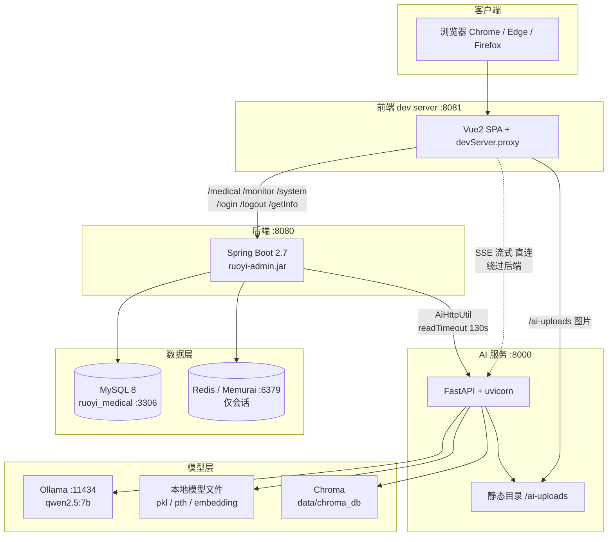

**端口与启动顺序（硬约束，见需求 6.2）：**

| 顺序 | 组件 | 端口 | 启动命令（Windows） | 未启动的后果 |
|------|------|------|---------------------|--------------|
| 1 | MySQL | 3306 | `net start MySQL80` | 后端启动失败 |
| 2 | Redis / Memurai | 6379 | `D:/Memurai/memurai.exe` | 应用可启动，**登录必失败** |
| 3 | 后端 | 8080 | `java -jar ruoyi-admin-1.0.0.jar --server.port=8080` | 全部业务不可用 |
| 4 | AI 服务 | 8000 | `uvicorn main:app --host 127.0.0.1 --port 8000` | 业务可用，AI 不可用 |
| 5 | Ollama | 11434 | `ollama serve` | 病历与 RAG 降级 |
| 6 | 前端 | 8081 | `npm run dev` | 无界面 |

> **决策依据**：后端必须显式传 `--server.port=8080`。若依启动类未硬编码端口，环境变量 `SERVER_PORT` 注入会导致端口漂移，前端代理全部失效。此约束写入 `start.bat` 而非代码，避免污染配置。

**四种部署形态：**

| 形态 | 说明 | 前端产物 |
|------|------|----------|
| 开发态 | 六进程全启，`npm run dev`（8081，含 proxy） | 无产物 |
| 演示态 | 同上，`start.bat` 一键拉起 | 无产物 |
| 生产态（裸机 Nginx） | 前端 `npm run build:prod` 产出 `dist/`（1.7MB），由宿主机 Nginx 托管并反向代理 `/medical` 等前缀到 8080、`/ai-uploads` 到 8000 | `ruoyi-ui/dist/` |
| 容器态（Docker） | `docker compose up -d --build` 一键编排 mysql/redis/backend/frontend/ai；前端镜像内置 Nginx，后端/AI 容器化，详见 2.3.1 | `ruoyi-ui/dist/`（镜像内） |

> **注意**：`package.json` 中**只有 `build:prod` / `build:stage`，没有 `build` 脚本**。CI 或部署脚本若写 `npm run build` 会直接失败。这是本项目的一个既有约定，不得"顺手改成 build"以免破坏已写好的部署文档。

### 2.3.1 容器化部署（Docker Compose，B-16 交付）

为降低换机 / 上云成本，提供 `docker-compose.yml` 一键编排 **mysql / redis / backend / frontend / ai** 五服务：

| 服务 | 镜像基础 | 端口映射 | 关键说明 |
|------|----------|----------|----------|
| `mysql` | `mysql:8.0` | `3306:3306` | 首次启动经 `/docker-entrypoint-initdb.d` 挂载 `docker/mysql/init-db.sh` 按序灌库；口令由 `MYSQL_ROOT_PASSWORD` 提供，缺省占位值见 `.env.example` |
| `redis` | `redis:7-alpine` | `6379:6379` | 仅会话令牌 |
| `backend` | 多阶段：`maven:3.9-eclipse-temurin-8` 构建 → `eclipse-temurin:8-jre` 运行 `ruoyi-admin-1.0.0.jar` | 仅 `expose 8080` | 注入 `DB_HOST=mysql` / `REDIS_HOST=redis` / `AI_SERVICE_URL=http://ai:8000`；健康检查探测 8080 端口（Spring Boot 完全刷新后才监听，避免误判） |
| `frontend` | 多阶段：`node:16` 构建 `build:prod` → `nginx:alpine` 托管 `dist/` | `8081:80` | `nginx.conf` 按路径直转 API 到 `backend:8080`、`/ai-uploads` 到 `ai:8000` |
| `ai` | `python:3.11-slim` 安装依赖 | `8000:8000` | `models/` 与 `data/` 经卷挂载复用宿主机已训练产物，不打包进镜像；`OLLAMA_HOST=host.docker.internal:11434` |

**编排要点：**
- 后端 `application.yml` 已支持 `DB_HOST` / `DB_PORT` / `REDIS_HOST` / `REDIS_PORT` / `AI_SERVICE_URL` 环境变量（缺省值与改造前一致），容器间通过服务名互通，**无需改代码**。
- 真实库口令不写死：在 compose 同级放 `.env`（模板见 `.env.example`）写 `DB_PASSWORD=<你的库口令>`，compose 与后端共用同一变量、自动对齐；未设置时使用仅供本机演示的占位值。
- Ollama 跑在宿主机（容器内不内置 GPU 推理），`ai` 服务经 `host.docker.internal` 访问；未启动时模块①病历、④RAG 自动降级。
- 灌库顺序（幂等）：`ry_20231130` → `medical_schema` → `followup` → `message` → `price` → `quartz` → `menu` → `ai_menu` → `drug_menu` → `clinic`（已含补丁 v2/v3）→ `medical_ai` → `patch_v4`（胸片三分类）→ `patch_v5`（诊疗 ID 串行化）。

> **已知边界**：容器化编排尚未在本开发沙箱实测 `docker build` / 启动（沙箱无 Docker），首次部署请在装有 Docker 的主机上执行 `docker compose up -d --build` 验证镜像构建与拉起。

### 2.4 组件依赖关系

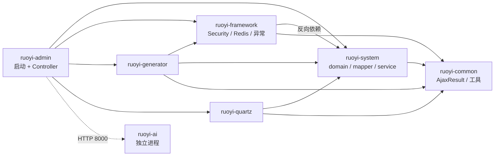

**架构异常点（必须知悉）**：依赖方向是 `ruoyi-framework → ruoyi-system → ruoyi-common`，即 **framework 依赖 system**，与官方 RuoYi（system → framework）相反。证据：`ruoyi-framework/pom.xml` 中存在 `<artifactId>ruoyi-system</artifactId>`。

- **直接后果**：`SecurityUtils` 位于 `ruoyi-framework/.../security/SecurityUtils.java`，而业务 Service 位于 `ruoyi-system`（不依赖 framework），**业务代码取当前登录用户只能用 `SecurityContextHolder`，不得使用 `SecurityUtils`**，否则编译失败。
- **决策依据**：这是裁剪过程中的历史产物，重构风险大于收益（需移动 12 个类并调整 4 个 pom）。
- **备选方案**：（A）把 `SecurityUtils` 下沉到 `ruoyi-common`——改动小，但会让 common 依赖 Spring Security 上下文，污染公共层；（B）反转依赖方向——最干净，但需同步调整 `ruoyi-admin` 的注入顺序。**当前取舍：维持现状，以编码约束（9.1 第 3 条）+ 本条文档说明兜底。**

---

### 2.5 AI 技术选型深度论证

第 2.2 节从工程角度给出了整体技术选型；本节针对 AI 子系统的三类核心组件，补充**与主流候选方案的正面对比**，论证其在"断网可用、轻量、消费级 GPU（实测 RTX 4050 6GB）"硬约束下的合理性。

#### 2.5.1 大语言模型选型：Qwen2.5-7B vs Llama-3-8B vs ChatGLM3-6B

| 维度 | **Qwen2.5-7B-Instruct（q4_K_M，采用）** | Llama-3-8B-Instruct | ChatGLM3-6B |
|------|------|------|------|
| 中文医疗术语能力 | 强，训练语料中文占比高 | 中等，英文为主需提示词补偿 | 强，原生中文优化 |
| 量化后体积 | 4.7GB（q4_K_M） | 4.7GB（q4） / 8GB（q8） | 约 4–6GB（INT4） |
| 消费级 GPU 显存 | RTX 4050 6GB 可跑 | 6GB 边缘（q4 勉强） | 6GB 可跑 |
| 离线部署 | Ollama 原生支持，断网可用 | Ollama 支持 | 需 ModelScope / 自托管 |
| 推理时延 | 病历生成 40–52s（满足 4.1 的 40–60s） | 相近 | 相近 |
| 结论 | **采用**：中文强 + 显存友好 + 离线成熟 | 备选：英文场景更优，但中文需额外提示 | 备选：中文强但生态与本项目 Ollama 链路耦合度低 |

> **决策**：在"病历结构化"任务上，Qwen2.5-7B 的中文指令遵循与病历四段式抽取质量达标，且 q4 量化可在 6GB 显存跑通，是满足"断网可用 + 消费级硬件"双重约束的最优解；更大模型（如 14B/72B）或云端 API 均因显存或离线约束被排除（见 2.2 D-08）。

#### 2.5.2 向量库与 Embedding：Chroma + MiniLM vs Milvus vs PGVector

| 维度 | **Chroma + paraphrase-multilingual-MiniLM-L12-v2（采用）** | Milvus | PGVector |
|------|------|------|------|
| 部署形态 | 单进程 + 本地 sqlite，零运维 | 独立分布式服务（etcd/minio） | 依赖 PostgreSQL 实例 |
| 知识库规模适配 | 10–20 条医疗条目，完全够用 | 百万级，过度设计 | 千级，依赖已有 PG |
| 外网依赖 | Embedding 本地固化，零运行时外网 | 同左（需自托管） | 同左 |
| 相似度过滤 | 支持余弦距离 + 自定义阈值（0.55 拒答） | 支持 | 支持 |
| 结论 | **采用**：最轻量，随代码提交即可 | 备选：规模上来再迁移 | 备选：若已有 PG 可省运维 |

> **决策**：本项目 RAG 知识库规模极小（10–20 条）且要求断网可用，Chroma 的"进程内 + 本地持久化"与 MiniLM 的多语言中英混排稳定性，是性价比最高的组合；Milvus / PGVector 的分布式能力在此场景下属于过度设计（见 2.2 D-09、D-10）。

#### 2.5.3 图像分类骨干：ResNet18 vs ResNet50 vs VGG16

| 维度 | **ResNet18（采用）** | ResNet50 | VGG16 |
|------|------|------|------|
| 参数量 | 约 1170 万 | 约 2550 万 | 约 1.38 亿 |
| 训练 / 推理成本 | 低，单卡数小时可训 | 中 | 高（显存占用大） |
| 小样本适配 | 残差结构抗过拟合，适配 8:2 划分 | 更深易过拟合需更强正则 | 易过拟合 |
| 少数类优化空间 | 配合过采样 + 类别加权损失即可显著提召回 | 同左但调参更敏感 | 同左 |
| 结论 | **采用**：胸片三分类任务饱和精度下最经济 | 备选：数据量增大后可换 | 备选：不推荐（参数量大、性价比低） |

> **决策**：胸片三分类在 ResNet18 上已达 val_acc 0.9416 / macro-F1 0.9428，继续加深网络带来的精度收益不足以抵消训练成本与过拟合风险；配合 WeightedRandomSampler + 类别加权 CrossEntropyLoss，ResNet18 已能把 COVID-19 召回率拉到 1.000（见 4.4.15、6.14.3）。

## 3 模块划分

### 3.1 模块 / 子系统职责边界

| 子系统 | 职责 | 对外接口前缀 | 不负责 |
|--------|------|--------------|--------|
| 认证登录 | 登录、获取用户信息、登出、token 续期 | `/login` `/getInfo` `/logout` | 用户/角色/菜单的维护（沿用若依原生表，无管理界面） |
| 患者管理 | 患者建档、身份证/手机号校验、档案查询 | `/medical/patient` | 就诊与用药（属诊疗/处方） |
| 排班管理 | 排班与号源维护 | `/medical/schedule` | 号源占用（属挂号，排班只提供额度） |
| 挂号管理 | 挂号（占号源）、退号、开始就诊 | `/medical/registration` | 诊疗内容填写（属诊疗） |
| 诊疗管理 | 诊疗记录 CRUD、费用汇总、AI 病历回填 | `/medical/diagnosis` | 处方开具（属处方） |
| 药品管理 | 药品目录、库存、效期预警 | `/medical/drug` | 库存变动（属发药/退药） |
| 价目管理 | 诊疗项目价目表 | `/medical/price` | 计价执行（属处方开方） |
| 处方发药 | 开方（计价+过敏校验）、发药、退药、作废 | `/medical/prescription` | 药品目录维护 |
| 随访管理 | 随访计划与记录 | `/medical/followup` | 随访提醒推送（属定时任务） |
| 站内信 | 消息列表、已读标记、未读统计 | `/medical/message` | 消息产生（由业务/定时任务写入） |
| 审计日志 | 关键操作留痕查询（只读） | `/medical/audit` | 任何写操作 |
| 统计看板 | 运营指标聚合 | `/medical/statistics` | 明细查询 |
| 定时任务 | Quartz 任务 CRUD、启停、日志 | `/monitor/job` | 具体业务动作（由 task 类实现） |
| AI 智能模块 | 病历生成、风险预测、胸片初筛、RAG 导诊 | `/medical/ai` | 业务落库判定（由 Java 侧 Service 决定） |

**边界判定的三条原则：**

1. **谁来改状态，就归谁。** 库存变动归"处方发药"而非"药品管理"；号源变动归"挂号管理"而非"排班管理"。
2. **只读聚合独立成模块。** 审计与统计均为只读，独立以避免与主业务耦合。
3. **AI 只产出，不决策。** AI 服务返回结论与概率，是否落库、落到哪张表由 Java 侧 `MedicalAiServiceImpl` 决定。

### 3.2 包与目录结构

**后端（Maven 多模块）**

```
若依医疗/
├── pom.xml                         父 POM，dependencyManagement 统一版本
├── ruoyi-admin/                    启动模块（打包 ruoyi-admin-1.0.0.jar）
│   └── src/main/java/com/ruoyi/
│       ├── RuoYiMedicalApplication.java        启动类
│       └── controller/             13 个 Controller + DispenseRequest
│   └── src/main/resources/
│       ├── application.yml         数据源/Redis/MyBatis/AI 配置
│       └── logback 相关（默认）
├── ruoyi-system/                   业务领域核心（65 个类）
│   └── src/main/java/com/ruoyi/system/
│       ├── domain/                 18 个 Medical* 实体 + dto/
│       ├── mapper/                 19 个 Mapper 接口
│       ├── service/                10 个接口 + impl/
│       └── utils/AiHttpUtil.java   AI 网关客户端
│   └── src/main/resources/mapper/  18 个 Mapper XML
├── ruoyi-common/                   公共（16 个类）
│   └── com/ruoyi/common/
│       ├── core/domain/            AjaxResult、BaseEntity
│       ├── core/page/              PageDomain、TableDataInfo、TableSupport
│       ├── core/redis/RedisCache.java
│       ├── exception/ServiceException.java
│       └── utils/                  AllergyChecker、DateUtils、StringUtils、poi/ExcelUtil
├── ruoyi-framework/                基础设施（12 个类）
│   └── com/ruoyi/framework/
│       ├── config/                 SecurityConfig、RedisConfig、CorsConfig、MyBatisConfig
│       ├── security/               JwtAuthenticationTokenFilter、SecurityUtils、登出与未认证处理
│       └── web/service/            SysLoginService、TokenService、UserDetailsServiceImpl
│       └── web/exception/          GlobalExceptionHandler
├── ruoyi-quartz/                   定时任务（20 个类），含 MedicalRemindTask、FollowupRemindTask
├── ruoyi-generator/                代码生成（11 个类，保留能力）
├── ruoyi-ui/                       前端
├── ruoyi-ai/                       AI 微服务（独立进程）
├── sql/                            14 个初始化脚本
└── doc/                            文档
```

**前端**

```
ruoyi-ui/src/
├── api/                            login.js、monitor/job.js、medical/*.js（11 个）
├── router/index.js                 静态路由（无动态路由）
├── permission.js                   路由守卫
├── plugins/index.js                全局挂载（$modal/$tab/download/resetForm/...）
├── directive/permission.js         v-hasPermi（当前恒放行）
├── components/                     Breadcrumb / Hamburger / Pagination（仅 3 个）
├── utils/request.js                axios 封装 + download()
├── views/
│   ├── medical/                    patient / diagnosis / drug / followup / message
│   │                               price / schedule / registration / prescription
│   │                               statistics / feeReport
│   ├── medical/ai/                 record / risk / xray / chat / knowledge
│   ├── monitor/job/                index / log
│   ├── dashboard/、login/、error/
└── store/、layout/、assets/
```

**AI 服务**

```
ruoyi-ai/
├── main.py          FastAPI 入口，9 个业务路由 + 静态挂载 + CORS + 启动预热
├── config.py        全部配置项（Ollama/RAG/风险/胸片/服务）
├── schemas.py       Pydantic 请求模型
├── prompts.py       病历与 RAG 提示词拼装
├── llm.py           Ollama 健康检查 / 非流式 / 流式 / 预热
├── fallback.py      Ollama 不可用时的 5 套病历模板
├── risk.py          sklearn 模型懒加载 + predict_proba + 风险分级
├── chest.py         ResNet18 懒加载 + 预处理 + softmax 三分类
├── rag.py           Chroma 检索 + 阈值过滤 + 拒答 + 会话记忆
├── scripts/         train_risk.py、train_chest.py、build_rag_db.py、rag_compare.py
├── models/          模型文件（不入库）
└── data/            chroma_db、uploads（不入库）
```

### 3.3 关键类及其职责

| 类 | 文件 | 职责 | 关键约束 |
|----|------|------|----------|
| `RuoYiMedicalApplication` | `ruoyi-admin/.../RuoYiMedicalApplication.java` | 启动类 | `exclude = DataSourceAutoConfiguration.class`，由 Druid starter 建数据源 |
| `SecurityConfig` | `framework/config/SecurityConfig.java` | 安全策略 | `csrf().disable()`；`STATELESS`；仅放行 `/login` `/logout` `/captchaImage` `/error` `/favicon.ico`；BCrypt 密码 |
| `JwtAuthenticationTokenFilter` | `framework/security/JwtAuthenticationTokenFilter.java` | token 解析与续期 | 从 `token` 头或 `Authorization: Bearer` 取；每次请求 refreshToken |
| `TokenService` | `framework/web/service/TokenService.java` | Redis 会话读写 | key = `login_tokens:` + token，TTL 30 分钟 |
| `GlobalExceptionHandler` | `framework/web/exception/GlobalExceptionHandler.java` | 全局异常出口 | 处理 `ServiceException` / `BindException` / `RuntimeException` / `Exception` |
| `AiHttpUtil` | `system/utils/AiHttpUtil.java` | AI 网关客户端 | `apiPrefix = base + "/api/ai"`；readTimeout 130s；内部异常类 `AiServiceException` |
| `MedicalRegistrationServiceImpl` | `system/service/impl/MedicalRegistrationServiceImpl.java` | 挂号占号源、退号、开始就诊 | 单号生成、状态机、号源原子 SQL、审计 |
| `MedicalPrescriptionServiceImpl` | `system/service/impl/MedicalPrescriptionServiceImpl.java` | 开方计价、发药、退药、作废 | 5 秒防重锁、效期校验、库存原子扣减、状态回算 |
| `MedicalStatisticsServiceImpl` | `system/service/impl/MedicalStatisticsServiceImpl.java` | 13 项指标聚合 | JVM 静态 Map 缓存，TTL 1 小时 |
| `MedicalAiServiceImpl` | `system/service/impl/MedicalAiServiceImpl.java` | AI 调用编排 + 落库 | 校验 Python 信封 `code == 200`；回填自增 ID |
| `AllergyChecker` | `common/utils/AllergyChecker.java` | 过敏冲突关键词匹配 | 规则表：青霉素→青霉素/阿莫西林/氨苄/头孢；磺胺→磺胺；头孢→头孢；阿司匹林→阿司匹林 |
| `MedicalRemindTask` | `quartz/task/MedicalRemindTask.java` | 低库存扫描推站内信 | 默认阈值 10；未读去重 |
| `AjaxResult` | `common/core/domain/AjaxResult.java` | 统一响应体 | `extends HashMap`，`code/msg/data` |
| `BaseEntity` | `common/core/domain/BaseEntity.java` | 实体基类 | **仅 5 字段**，无 `params`（见 3.4） |
| `TableSupport` | `common/core/page/TableSupport.java` | 分页结果封装 | `getDataTable(list, total)` |

### 3.4 关键设计约束（源自裁剪）

| 约束 | 说明 | 违反后果 |
|------|------|----------|
| `BaseEntity` 无 `params` 字段 | 官方 RuoYi 的 `Map<String,Object> params` 已移除 | Mapper XML **禁止**写 `params.beginTime`；时间范围查询改用实体上的显式 `beginXxx/endXxx` 字段 |
| 无 `@PreAuthorize` / `@Log` / `BusinessType` | 这三个类不存在于 common 模块 | 业务 Controller **禁止**使用这些注解，否则编译失败 |
| 业务 Controller 不继承 `BaseController` | 裁剪版约定 | 自写私有 `toAjax(int)`；分页用 `PageHelper.startPage` + `TableSupport.getDataTable` |
| 系统层禁用 `SecurityUtils` | 依赖方向反转（2.4） | 编译失败；改用 `SecurityContextHolder` |
| Vue `methods` 禁止定义 `resetForm` | 全局已挂 `Vue.prototype.resetForm` | 遮蔽全局方法 → 无限递归；改名为 `handleReset` |
| Vue2 不支持 `:deep()` | 版本限制 | 深度选择器用 `::v-deep` 或内联 style |

---

## 4 数据库设计

### 4.1 目的和作用

将《项目需求文档》中识别的业务对象与关系，整理为可在 MySQL 8.0 上直接建库的物理模型，明确每张表的字段、类型、主外键语义、索引与约束，并规定初始化脚本的执行顺序与迁移策略，使开发、测试、演示三套环境可重复搭建出一致的库结构。

### 4.2 系统物理结构设计

| 项 | 规定 |
|----|------|
| 数据库 | MySQL 8.0，库名 `ruoyi_medical`，字符集 `utf8mb4` |
| 存储引擎 | 全部业务表 `InnoDB` |
| 主键策略 | 统一 `BIGINT(20) AUTO_INCREMENT` 代理主键；**唯一例外** `medical_diagnosis` 采用 `MAX(id)+1` 显式赋值（见 4.5 与附录 B-06） |
| 外键 | **不建物理外键**，全部为应用层语义外键。理由：物理外键会阻碍单表清理与数据迁移，且本系统外键语义由 Service 保证 |
| 金额类型 | 一律 `DECIMAL(10,2)`；概率类 `DECIMAL(6,4)` |
| 状态字段 | 一律 `CHAR(1)`，取值含义写在列注释中（如 `'0待发药 1部分发药 2已发药 3已作废'`） |
| 时间字段 | `DATETIME`（业务时间）/ `DATE`（效期、排班日）；审计表复用 `create_time` 作为操作时间 |
| 审计字段 | 业务表统一带 `create_by/create_time/update_by/update_time/remark` |
| 容量估算 | 单机构年门诊量按 10 万计：`medical_audit_log` 年增约 40 万行（4 类动作），`medical_diagnosis` 年增约 10 万行，其余表量级均在万行以内；全库年增约 100MB，无需分表 |
| 访问频度 | 高频写：`medical_audit_log`；高频读：`medical_drug`（开方/发药）、`medical_schedule`（挂号）、`medical_message`（未读轮询） |
| 命名 | 数据文件与日志文件沿用 MySQL 默认（`ibdata1` / `binlog`），无需单独规划 |

### 4.3 整体 E-R 关系（见 1.3）

### 4.4 表设计

> 表格列：列名 / 类型 / 约束 / 注释。约束栏中 PK=主键、NN=非空、UQ=唯一、IDX=索引、FK=语义外键。
> 为节省篇幅，所有表共有的 `create_by VARCHAR(64)`、`create_time DATETIME`、`update_by VARCHAR(64)`、`update_time DATETIME`、`remark VARCHAR(500)` 审计列统一标注为「审计列（5 项）」，不再逐行展开；无 `update_*` 的表会显式说明。

#### 4.4.1 患者信息表 `medical_patient`

对应需求 FR-3.2 / AC-02。代码：`MedicalPatient.java`、`MedicalPatientMapper.xml`。

| 列名 | 类型 | 约束 | 注释 |
|------|------|------|------|
| `patient_id` | BIGINT(20) | PK, NN, AUTO_INCREMENT | 患者ID |
| `patient_name` | VARCHAR(50) | NN | 患者姓名 |
| `gender` | CHAR(1) | DEFAULT '2' | 性别（0男 1女 2未知） |
| `birth_date` | DATE | NULL | 出生日期 |
| `id_card` | VARCHAR(18) | DEFAULT '' | 身份证号，服务端 `@Pattern` 校验 |
| `phone` | VARCHAR(11) | DEFAULT '' | 联系电话，服务端 `@Pattern` 校验 |
| `address` | VARCHAR(200) | DEFAULT '' | 住址 |
| `blood_type` | VARCHAR(10) | DEFAULT '' | 血型（A/B/O/AB） |
| `allergy_history` | VARCHAR(500) | DEFAULT '' | **过敏史，过敏校验的真相源** |
| `past_history` | VARCHAR(500) | DEFAULT '' | 既往病史 |
| `status` | CHAR(1) | DEFAULT '0' | 状态（0正常 1住院 2出院 3死亡） |
| 审计列 | — | — | 5 项 |

> **决策依据**：`allergy_history` 采用自由文本 + 关键词匹配，而非结构化的过敏原字典表。理由：门诊演示场景下医生录入习惯是自由文本，引入字典表会让建档流程变重。**备选方案**：建 `medical_allergy_dict` 字典表 + 中间表（放弃）——数据质量更高，但需额外维护界面，与"轻量级"定位冲突。

#### 4.4.2 号源排班表 `medical_schedule`

对应需求 FR-3.10 / AC-09。代码：`MedicalSchedule.java`、`MedicalScheduleMapper.xml`。

| 列名 | 类型 | 约束 | 注释 |
|------|------|------|------|
| `schedule_id` | BIGINT(20) | PK, NN, AI | 排班ID |
| `dept` | VARCHAR(50) | NN | 科室 |
| `doctor_name` | VARCHAR(50) | NN | 出诊医生 |
| `schedule_date` | DATE | NN, IDX(`idx_sched_date`) | 排班日期，前端统一格式化 `yyyy-MM-dd` |
| `period` | CHAR(1) | DEFAULT '0' | 时段（0上午 1下午） |
| `total_num` | INT(11) | DEFAULT 0 | 号源总数 |
| `used_num` | INT(11) | DEFAULT 0 | 已挂号数，原子增减（见 4.5） |
| `status` | CHAR(1) | DEFAULT '0' | 状态（0出诊 1停诊） |
| 审计列 | — | — | 5 项 |

**约束**：`UNIQUE KEY uk_sched (dept, doctor_name, schedule_date, period)` —— 防止同一医生同一时段重复排班。

#### 4.4.3 挂号表 `medical_registration`

对应需求 FR-3.3 / AC-03、AC-04。代码：`MedicalRegistration.java`、`MedicalRegistrationMapper.xml`。

| 列名 | 类型 | 约束 | 注释 |
|------|------|------|------|
| `registration_id` | BIGINT(20) | PK, NN, AI | 挂号ID |
| `reg_no` | VARCHAR(30) | NN, **UQ**(`uk_reg_no`) | 挂号号 `GH+yyyyMMdd+4位随机` |
| `patient_id` | BIGINT(20) | NN, IDX, FK→patient | 患者ID |
| `patient_name` | VARCHAR(50) | DEFAULT '' | 患者姓名（冗余，便于列表展示，避免 join） |
| `schedule_id` | BIGINT(20) | NULL, IDX, FK→schedule | 关联号源排班ID |
| `dept` | VARCHAR(50) | DEFAULT '' | 科室 |
| `doctor_name` | VARCHAR(50) | DEFAULT '' | 接诊医生 |
| `reg_type` | CHAR(1) | DEFAULT '0' | 挂号类型（0普通 1专家 2急诊） |
| `reg_fee` | DECIMAL(10,2) | DEFAULT 0.00 | 挂号费 |
| `reg_status` | CHAR(1) | DEFAULT '0' | **状态机**：0待就诊 1已就诊 2已退号 |
| `reg_time` | DATETIME | NULL | 挂号时间 |
| 审计列 | — | — | 5 项 |

> **决策依据**：`patient_name` 冗余存储。理由：挂号列表是高频查询，冗余可避免每次 join `medical_patient`。**代价**：患者改名后历史挂号单姓名不会同步。**取舍**：门诊业务中患者改名极少，且历史单据应保持开具时快照，故冗余是正确选择。

#### 4.4.4 诊疗信息表 `medical_diagnosis`

对应需求 FR-3.4 / AC-08。代码：`MedicalDiagnosis.java`、`MedicalDiagnosisMapper.xml`。

| 列名 | 类型 | 约束 | 注释 |
|------|------|------|------|
| `diagnosis_id` | BIGINT(20) | PK, NN, AI | 诊疗ID（**应用层原子分配**，语义仍为 MAX+1，见 4.4.17 与 6.5） |
| `patient_id` | BIGINT(20) | NN, IDX(`idx_patient_id`), FK→patient | 患者ID |
| `registration_id` | BIGINT(20) | NULL, IDX(`idx_diag_reg`), FK→registration | 关联挂号ID（由"开始就诊"写入） |
| `visit_date` | DATETIME | NN, IDX(`idx_visit_date`) | 就诊日期 |
| `department` | VARCHAR(50) | NN | 就诊科室 |
| `doctor_name` | VARCHAR(50) | NN | 主治医生 |
| `chief_complaint` | VARCHAR(500) | DEFAULT '' | 主诉 |
| `present_illness` | VARCHAR(1000) | DEFAULT '' | 现病史 |
| `diagnosis_result` | VARCHAR(500) | **NN** | 诊断结果（草稿态写 `'待完善'`） |
| `treatment_plan` | VARCHAR(1000) | DEFAULT '' | 治疗方案 |
| `cost` | DECIMAL(10,2) | DEFAULT 0.00 | 诊疗费用 |
| `status` | CHAR(1) | DEFAULT '0' | 状态（0待就诊 1就诊中 2已完成）；草稿态为 `'1'` |
| 审计列 | — | — | 5 项 |

> **决策依据**：`diagnosis_result` 设为 `NOT NULL`，因此"开始就诊"生成草稿时必须写占位值 `'待完善'`，主诉/现病史/方案写空串。**备选方案**：把三列改为可空（放弃）——草稿与正式记录将难以区分，且 `fee-summary` 聚合时会出现 NULL 参与运算的额外分支。


#### 4.4.5 药品信息表 `medical_drug`

对应需求 FR-3.5 / AC-10。代码：`MedicalDrug.java`、`MedicalDrugMapper.xml`。

| 列名 | 类型 | 约束 | 注释 |
|------|------|------|------|
| `drug_id` | BIGINT(20) | PK, NN, AI | 药品ID |
| `drug_name` | VARCHAR(100) | NN, IDX(`idx_drug_name`) | 药品名称（**价目表按此名匹配计价**） |
| `drug_code` | VARCHAR(50) | DEFAULT '' | 药品编码 |
| `category` | CHAR(1) | DEFAULT '0', IDX | 分类（0西药 1中药 2中成药 3生物制品） |
| `spec` | VARCHAR(100) | DEFAULT '' | 规格 |
| `manufacturer` | VARCHAR(200) | DEFAULT '' | 生产厂家 |
| `unit` | VARCHAR(20) | DEFAULT '' | 包装单位 |
| `purchase_price` | DECIMAL(10,2) | DEFAULT 0.00 | 进价 |
| `sale_price` | DECIMAL(10,2) | DEFAULT 0.00 | 售价 |
| `stock` | INT(11) | DEFAULT 0 | **库存数量，原子增减字段** |
| `production_date` | DATE | NULL | 生产日期 |
| `expiry_date` | DATE | NULL | **有效期至，发药红线** |
| `status` | CHAR(1) | DEFAULT '0' | 状态（0正常 1停用） |
| 审计列 | — | — | 5 项 |

#### 4.4.6 处方主表 `medical_prescription`

对应需求 FR-3.6 / AC-05。代码：`MedicalPrescription.java`、`MedicalPrescriptionMapper.xml`。

| 列名 | 类型 | 约束 | 注释 |
|------|------|------|------|
| `prescription_id` | BIGINT(20) | PK, NN, AI | 处方ID |
| `prescription_no` | VARCHAR(30) | NN, **UQ**(`uk_pres_no`) | 处方号 `CF+yyyyMMdd+4位随机` |
| `registration_id` | BIGINT(20) | NULL, IDX, FK→registration | 关联挂号ID |
| `patient_id` | BIGINT(20) | NN, IDX, FK→patient | 患者ID |
| `patient_name` | VARCHAR(50) | DEFAULT '' | 患者姓名（冗余） |
| `doctor_name` | VARCHAR(50) | DEFAULT '' | 开方医生 |
| `dept` | VARCHAR(50) | DEFAULT '' | 科室 |
| `diagnosis` | VARCHAR(500) | DEFAULT '' | 诊断 |
| `total_amount` | DECIMAL(10,2) | DEFAULT 0.00 | 处方总金额（开方时按价目表计算） |
| `prescription_status` | CHAR(1) | DEFAULT '0' | **状态机**：0待发药 1部分发药 2已发药 3已作废 |
| 审计列 | — | — | 5 项 |

> **重要设计说明**：实体 `MedicalPrescription` 中存在 `patientAllergy` 字段，但**数据库无对应列，insert 时不写入**。这是**有意设计**：
> - 过敏史的真相源是 `medical_patient.allergy_history`，开方时由 Service 读出后临时放入实体参与校验；
> - 校验结果（警示文案）持久化在 `medical_prescription_item.allergy_warning`；
> - **决策依据**：若把过敏史快照进处方表，患者后续更新过敏史会造成"历史处方过敏信息与患者档案不一致"的歧义。**备选方案**：加列 `patient_allergy VARCHAR(500)`（放弃）——看似完整，实则会与患者档案产生双真相源。此约定已在实体类注释中固化，修改时务必保留。

#### 4.4.7 处方明细表 `medical_prescription_item`

对应需求 FR-3.6 / AC-05、AC-06。

| 列名 | 类型 | 约束 | 注释 |
|------|------|------|------|
| `item_id` | BIGINT(20) | PK, NN, AI | 明细ID |
| `prescription_id` | BIGINT(20) | NN, IDX(`idx_item_pres`), FK→prescription | 处方ID |
| `drug_id` | BIGINT(20) | NN, IDX(`idx_item_drug`), FK→drug | 药品ID |
| `drug_name` | VARCHAR(100) | DEFAULT '' | 药品名称（冗余） |
| `spec` | VARCHAR(100) | DEFAULT '' | 规格 |
| `quantity` | INT(11) | NN, DEFAULT 0 | **开方数量** |
| `price` | DECIMAL(10,2) | DEFAULT 0.00 | 单价（优先取价目表，其次取药品售价） |
| `dosage` | VARCHAR(100) | DEFAULT '' | 用法用量 |
| `dispensed_quantity` | INT(11) | DEFAULT 0 | **已发数量**（支持分次发药） |
| `allergy_warning` | VARCHAR(200) | NULL | 用药安全警示文案 |
| `create_by` / `create_time` | — | — | **仅 2 项审计列，无 update_\*** |

#### 4.4.8 发药记录表 `medical_dispensing`

对应需求 FR-3.6 / AC-06、AC-07。

| 列名 | 类型 | 约束 | 注释 |
|------|------|------|------|
| `dispensing_id` | BIGINT(20) | PK, NN, AI | 发药ID |
| `prescription_id` | BIGINT(20) | NN, IDX, FK→prescription | 处方ID |
| `item_id` | BIGINT(20) | NN, FK→prescription_item | 处方明细ID |
| `drug_id` | BIGINT(20) | NN, IDX, FK→drug | 药品ID |
| `drug_name` | VARCHAR(100) | DEFAULT '' | 药品名称（冗余） |
| `quantity` | INT(11) | NN, DEFAULT 0 | 本次发药数量 |
| `operator` | VARCHAR(50) | DEFAULT '' | 发药人 |
| `dispensing_time` | DATETIME | NULL | 发药时间 |
| `status` | CHAR(1) | DEFAULT '0' | **0正常 1已退**（退药为标记，不做物理删除） |
| `create_by` / `create_time` | — | — | 仅 2 项审计列 |

> **决策依据**：退药采用**状态标记 + 新增回滚语义**，而非删除发药记录。理由：药品流向必须可追溯，删除会丢失"曾经发出过"的事实。**备选方案**：物理删除发药行（放弃）——库存能回滚，但审计链断裂。

#### 4.4.9 医疗费用价目表 `medical_price_item`

对应需求 FR-3.9。

| 列名 | 类型 | 约束 | 注释 |
|------|------|------|------|
| `item_id` | BIGINT(20) | PK, NN, AI | 价目ID |
| `item_type` | VARCHAR(20) | NN, IDX(`idx_price_type`) | 项目类别（挂号费/诊查费/检查费/化验费/治疗费/手术费/护理费/床位费/药品/其它） |
| `item_name` | VARCHAR(100) | NN | 项目名称 |
| `spec` | VARCHAR(100) | DEFAULT '' | 规格/说明 |
| `unit` | VARCHAR(20) | DEFAULT '' | 计价单位 |
| `price` | DECIMAL(10,2) | DEFAULT 0.00 | 价格 |
| `insurance_flag` | CHAR(1) | DEFAULT '1' | 医保标记（0自费 1医保） |
| `status` | CHAR(1) | DEFAULT '0' | 状态（0启用 1停用） |
| `remark` | VARCHAR(200) | NULL | 备注（**无审计列**） |

> **计价匹配规则**：开方时执行 `SELECT ... WHERE item_type='药品' AND item_name=#{drugName} AND status='0' LIMIT 1`。**决策依据**：以"药品名称"为匹配键而非 `drug_id`，因为价目表服务于全部收费项目，不只为药品服务。**代价**：药品改名会导致计价失效（需同步改价目表）。已在 FR-3.9 提示"缺失项目需先维护"。

#### 4.4.10 患者随访记录表 `medical_followup`

对应需求 FR-3.7。

| 列名 | 类型 | 约束 | 注释 |
|------|------|------|------|
| `followup_id` | BIGINT(20) | PK, NN, AI | 随访ID |
| `patient_id` | BIGINT(20) | NN, IDX, FK→patient | 患者ID |
| `followup_date` | DATETIME | NULL, IDX | 随访日期 |
| `followup_type` | CHAR(1) | DEFAULT '0' | 方式（0电话 1微信 2上门） |
| `content` | VARCHAR(1000) | DEFAULT '' | 随访内容 |
| `next_followup_date` | DATE | NULL | 下次随访日期 |
| `status` | CHAR(1) | DEFAULT '0' | 状态（0待随访 1已完成） |
| `followup_person` | VARCHAR(50) | DEFAULT '' | 随访人 |
| 审计列 | — | — | 5 项 |

#### 4.4.11 站内信消息表 `medical_message`

对应需求 FR-3.8。

| 列名 | 类型 | 约束 | 注释 |
|------|------|------|------|
| `message_id` | BIGINT(20) | PK, NN, AI | 消息ID |
| `title` | VARCHAR(100) | NN, DEFAULT '' | 标题 |
| `content` | VARCHAR(500) | NN, DEFAULT '' | 内容 |
| `type` | CHAR(1) | NN, DEFAULT '0' | 类型（0系统 1低库存预警 2随访逾期提醒） |
| `receiver` | VARCHAR(64) | NN, DEFAULT 'admin' | **接收人 = 系统登录用户名（非姓名）** |
| `read_status` | CHAR(1) | NN, DEFAULT '0' | 阅读状态（0未读 1已读） |
| `related_id` | BIGINT(20) | NULL | 关联业务ID（随访ID/药品ID等） |
| `create_time` | DATETIME | NULL | 创建时间（**唯一时间列，无 create_by**） |

**索引**：`idx_receiver_read (receiver, read_status)` 支撑未读统计；`idx_type_related (type, related_id)` 支撑去重查询。

> **易错点**：`receiver` 存的是**登录用户名**（如 `admin`），不是患者/员工姓名。前端传参时必须传当前登录用户名，否则查不到消息。

#### 4.4.12 医疗操作审计日志表 `medical_audit_log`

对应需求 FR-3.11 / AC-16。

| 列名 | 类型 | 约束 | 注释 |
|------|------|------|------|
| `log_id` | BIGINT(20) | PK, NN, AI | 日志ID |
| `module` | VARCHAR(30) | DEFAULT '', IDX | 业务模块（挂号/处方/发药/退药/退号） |
| `action` | VARCHAR(30) | DEFAULT '' | 操作动作 |
| `biz_id` | BIGINT(20) | NULL | 业务主键（**软关联**，无物理外键） |
| `biz_no` | VARCHAR(50) | DEFAULT '' | 业务单号（挂号号/处方号） |
| `operator` | VARCHAR(50) | DEFAULT '' | 操作人（登录账号，取不到时为 `system`） |
| `detail` | VARCHAR(500) | NULL | 操作明细 |
| `create_by` / `create_time` | — | — | `create_time` 即操作时间 |

#### 4.4.13 AI 病历生成记录表 `medical_ai_record`

对应需求 FR-3.14.1 / AC-11。

| 列名 | 类型 | 约束 | 注释 |
|------|------|------|------|
| `record_id` | BIGINT(20) | PK, NN, AI | 记录ID |
| `patient_id` | BIGINT(20) | NULL, IDX, FK→patient | 患者ID（可空，支持临时书写） |
| `patient_name` | VARCHAR(50) | DEFAULT '' | 患者姓名 |
| `age` / `gender` | INT / VARCHAR(10) | NULL | 年龄 / 性别 |
| `chief_complaint` | VARCHAR(500) | DEFAULT '' | 主诉 |
| `ai_content` | TEXT | NULL | **AI 生成原文** |
| `doctor_content` | TEXT | NULL | **医生修改后内容**（留痕对比） |
| `engine` | VARCHAR(30) | DEFAULT '' | 引擎（`ollama` / `template`） |
| `model_name` | VARCHAR(50) | DEFAULT '' | 模型名 |
| `degraded` | CHAR(1) | DEFAULT '0' | 是否降级（0否 1是） |
| `elapsed_ms` | BIGINT | NULL | 推理耗时 |
| `status` | CHAR(1) | DEFAULT '0' | 状态（0草稿 1已采纳 2已废弃） |
| `diagnosis_id` | BIGINT(20) | NULL, FK→diagnosis | 采纳后回填的诊疗ID |
| 审计列 | — | — | `create_by` / `create_time` / `remark` |

> **决策依据**：`ai_content` 与 `doctor_content` **分列存储**，不做覆盖。理由：医疗场景下"AI 给了什么建议、医生改成了什么"是必须可回溯的证据链。**备选方案**：单列存最终内容（放弃）——实现简单，但失去人机差异的可审计性，答辩时无法证明 AI 仅为辅助。

#### 4.4.14 疾病风险预测记录表 `medical_risk_predict`

对应需求 FR-3.14.2 / AC-12。

| 列名 | 类型 | 约束 | 注释 |
|------|------|------|------|
| `predict_id` | BIGINT(20) | PK, NN, AI | 预测记录ID |
| `patient_id` | BIGINT(20) | NULL, IDX, FK→patient | 患者ID |
| `disease_name` | VARCHAR(50) | DEFAULT '' | 预测病种 |
| `feature_json` | VARCHAR(1000) | DEFAULT '' | **入参特征快照（带特征名）**，保证结果可复现 |
| `risk_prob` | DECIMAL(6,4) | NULL | 患病概率 0~1 |
| `result_label` | CHAR(1) | DEFAULT '0' | 结论（0低风险 1高风险） |
| `risk_level` | VARCHAR(20) | DEFAULT '' | 风险等级文案 |
| `advice` | VARCHAR(500) | DEFAULT '' | 健康建议 |
| `threshold` | DECIMAL(6,4) | NULL | 判定阈值快照 |
| `model_metrics` | VARCHAR(500) | DEFAULT '' | 模型指标快照（accuracy/auc 等） |
| 审计列 | — | — | `create_by` / `create_time` |

> **决策依据**：`feature_json` 与 `model_metrics` 均为**快照**而非外键关联。理由：模型会重训、阈值会调整，只有快照才能保证"这条历史结论当时是怎么得出的"可复现。

#### 4.4.15 胸片 AI 初筛记录表 `medical_chest_xray`

对应需求 FR-3.14.3 / AC-13。

| 列名 | 类型 | 约束 | 注释 |
|------|------|------|------|
| `xray_id` | BIGINT(20) | PK, NN, AI | 记录ID |
| `patient_id` | BIGINT(20) | NULL, IDX, FK→patient | 患者ID |
| `img_url` | VARCHAR(255) | DEFAULT '' | 影像访问路径，形如 `/ai-uploads/xxx.png` |
| `predict_result` | VARCHAR(50) | DEFAULT '' | **三分类结果文案**（COVID-19 / NORMAL / Viral Pneumonia） |
| `confidence` | DECIMAL(6,4) | NULL | 最大类置信度 |
| `probs_json` | VARCHAR(500) | DEFAULT '' | **三分类全概率 JSON**，前端进度条数据源 |
| `device` | VARCHAR(20) | DEFAULT '' | 推理设备（cuda/cpu） |
| `elapsed_ms` | BIGINT | NULL | 推理耗时 |
| 审计列 | — | — | `create_by` / `create_time` |

> **迁移缺口（必须修复）**：`sql/medical_ai.sql` 中该表的建表语句**仍是二分类形态**（含 `result_label` / `prob_normal` / `prob_abnormal`，**缺 `probs_json` 列**），而代码（`MedicalChestXray.java`、`MedicalChestXrayMapper.xml` 的 resultMap 与 insert）已按三分类读写 `probs_json`。全库 SQL 中不存在任何 `ALTER TABLE ... ADD probs_json` 语句。
> **后果**：按 `sql/` 脚本全新导入的库，执行胸片识别会报 `Unknown column 'probs_json' in 'field list'`（AC-13 将导致功能不可用）。开发机之所以正常，是因为手工 ALTER 过。
> **修复**：见 4.6 迁移脚本 M3。同时应删除已废弃的 `result_label` / `prob_normal` / `prob_abnormal` 三列（代码已不再读写）。

#### 4.4.16 RAG 导诊知识条目表 `medical_rag_knowledge`

对应需求 FR-3.14.4 / AC-14。

| 列名 | 类型 | 约束 | 注释 |
|------|------|------|------|
| `knowledge_id` | BIGINT(20) | PK, NN, AI | 主键 |
| `title` | VARCHAR(200) | DEFAULT '' | 标题 |
| `content` | TEXT | NULL | 知识正文 |
| `category` | VARCHAR(50) | DEFAULT '', IDX | 分类（常见病/用药/检查/保健） |
| `synced` | CHAR(1) | DEFAULT '0', IDX(`idx_rag_synced`) | **是否已入向量库**（0未同步 1已同步） |
| 审计列 | — | — | `create_by` / `create_time` / `remark`（**无 update_\***） |

> **决策依据**：用 `synced` 标记位而非每次全量重建向量库。**理由**：知识条目变更是低频事件，增量同步可避免全量重算的耗时与抖动。**幂等设计**：查询未同步项用 `WHERE synced='0' OR synced IS NULL`；`insert` / `update` 实体时**强制 `setSynced("0")`**，保证正文一变就必须重新入库。
#### 4.4.17 业务 ID 分配器表 `medical_id_allocator`（V1.0 新增）

对应需求 FR-3.4 / AC-08。代码：`MedicalIdAllocator.java`、`MedicalIdAllocatorMapper.java/.xml`、`MedicalIdAllocatorServiceImpl.java`。

| 列名 | 类型 | 约束 | 注释 |
|------|------|------|------|
| `biz_key` | VARCHAR(50) | PK, NN | 业务标识，当前仅 `diagnosis` |
| `last_id` | BIGINT(20) | NN, DEFAULT 0 | 最近一次分配出的 ID（**仅审计/排障，不参与下次分配**） |
| `update_time` | DATETIME | NULL | 更新时间 |

**建表与初始化脚本**：`sql/medical_patch_v5.sql`（`CREATE TABLE IF NOT EXISTS` + `INSERT ... ON DUPLICATE KEY UPDATE`，幂等）。

> **为什么需要这张表**：AC-08 要求"删除后新增复用该 ID"，即取值必须是 `MAX(diagnosis_id)+1`，而 MySQL `AUTO_INCREMENT` 只增不回收，二者语义冲突；但直接 `SELECT MAX()+1` 再 `INSERT` 存在 check-then-act 竞态，并发必然撞主键。本表以 `biz_key` 单行作为 `SELECT ... FOR UPDATE` 的行锁载体，把并发取号串行化。
>
> **为什么 `last_id` 不参与计算**：一旦用它做递增计数器，删除最大 ID 后就再也不会复用该 ID，AC-08 立刻失效。这是本方案与"自增计数器表"的关键区别。
>
> **备选方案与取舍**：
> | 备选 | 结论 |
> |------|------|
> | 改为 `AUTO_INCREMENT` | **放弃**——直接违背 AC-08 |
> | 乐观锁 `@Version` + 重试 | 放弃——诊疗无 version 列，且重试循环让代码复杂化 |
> | `SELECT GET_LOCK()` 命名锁 | 可行，但锁是会话级、需显式释放，异常路径易漏；且无法在事务边界自动回收 |
> | 仅靠主键唯一约束失败重试 | 放弃——撞键后事务已标记回滚，重试语义不安全；仅作为兜底防线保留 |
> | **独立分配表 + 行锁事务** | **采用**——锁随事务提交自动释放，语义明确，且天然支持横向扩展为其他业务取号 |


#### 4.4.18 若依原生表与代码生成表（沿用，不重复设计）

| 表 | 用途 | 说明 |
|----|------|------|
| `sys_user` / `sys_role` / `sys_menu` / `sys_user_role` / `sys_role_menu` / `sys_dept` 等 | 用户、角色、菜单 | 沿用若依原生结构；RBAC 仅到菜单级 |
| `sys_job` / `sys_job_log` + `qrtz_*` | Quartz 任务与日志 | 业务任务 `job_id` 从 **100** 起（1/2/3 被系统任务占用） |
| `gen_table` / `gen_table_column` | 代码生成业务表 | 由 `ruoyi-generator` 维护 |

### 4.5 索引与关键约束汇总

| 表 | 索引 | 类型 | 服务场景 |
|----|------|------|----------|
| `medical_patient` | `PRIMARY(patient_id)` | PK | 主键 |
| `medical_diagnosis` | `idx_patient_id`、`idx_diag_reg`、`idx_visit_date` | IDX | 按患者查、按挂号反查、费用趋势按月聚合 |
| `medical_drug` | `idx_drug_name`、`idx_category` | IDX | 开方按名计价、分类统计 |
| `medical_schedule` | **`uk_sched(dept,doctor_name,schedule_date,period)`**、`idx_sched_date` | UQ + IDX | 防重复排班；按日期过滤可选号源 |
| `medical_registration` | **`uk_reg_no`**、`idx_reg_patient`、`idx_reg_schedule` | UQ + IDX | 单号唯一；按患者/排班查 |
| `medical_prescription` | **`uk_pres_no`**、`idx_pres_patient`、`idx_pres_reg` | UQ + IDX | 处方号唯一 |
| `medical_prescription_item` | `idx_item_pres`、`idx_item_drug` | IDX | 按处方取明细 |
| `medical_dispensing` | `idx_dispense_pres`、`idx_dispense_drug` | IDX | 发药历史、退药定位 |
| `medical_message` | `idx_receiver_read(receiver,read_status)`、`idx_type_related(type,related_id)` | 复合 IDX | 未读统计、推送去重 |
| `medical_audit_log` | `idx_audit_module`、`idx_audit_time` | IDX | 按模块/时间检索 |
| `medical_rag_knowledge` | `idx_rag_synced`、`idx_rag_category` | IDX | 未同步项扫描 |

**并发正确性的两条原子 SQL（系统最重要的数据约束）：**

```sql
-- ① 库存扣减：0 行 = 库存不足（AC-06）
UPDATE medical_drug SET stock = stock - #{quantity}
 WHERE drug_id = #{drugId} AND stock >= #{quantity};

-- ② 号源占用：0 行 = 号源已满（AC-03）
UPDATE medical_schedule SET used_num = used_num + 1
 WHERE schedule_id = #{scheduleId} AND used_num < total_num;
```

**决策依据（对应 D-03）**：把"判断 + 修改"压进同一条 SQL 的 `WHERE` 条件，由数据库保证原子性，Service 只需判断影响行数。**备选方案与取舍**：

| 备选 | 为什么放弃 |
|------|-----------|
| `SELECT` 判断后再 `UPDATE` | 存在 check-then-act 竞态，并发下必然超卖 |
| `SELECT ... FOR UPDATE` 悲观锁 | 锁持有跨越网络往返，且在 RC 隔离级别下仍易误用 |
| 乐观锁 `@Version` | 需引入重试循环与冲突处理分支，代码复杂度上升 |
| Redis 分布式锁 | 引入新故障域；本系统单实例单库，收益为零 |

**对称回退 SQL：**

```sql
UPDATE medical_drug SET stock = stock + #{quantity} WHERE drug_id = #{drugId};          -- 退药回滚
UPDATE medical_schedule SET used_num = used_num - 1
 WHERE schedule_id = #{scheduleId} AND used_num > 0;                                     -- 退号释放
UPDATE medical_message SET read_status='1' WHERE receiver=#{receiver} AND read_status='0'; -- 已读（天然幂等）
```

### 4.6 初始化与迁移策略

#### 4.6.1 初始化脚本执行顺序（必须严格按序）

| 序 | 脚本 | 内容 | 备注 |
|----|------|------|------|
| 1 | `sql/ry_20231130.sql` | 若依原生基线（sys_*、qrtz_*） | 会 `DROP TABLE IF EXISTS` 后重建 |
| 2 | `sql/medical_schema.sql` | 患者、诊疗、药品 + 种子数据 + `gen_table*` | 种子数据含 5 患者 / 5 诊疗 / 6 药品 |
| 3 | `sql/medical_followup.sql` | `medical_followup` | |
| 4 | `sql/medical_message.sql` | `medical_message` | |
| 5 | `sql/quartz.sql` | `sys_job` / `sys_job_log` | 需先手动 DROP 已存在的同名表 |
| 6 | `sql/medical_menu.sql` | 菜单与按钮 | 幂等写法（`SELECT ... FROM DUAL WHERE NOT EXISTS`） |
| 7 | `sql/medical_price.sql` | `medical_price_item` 价目 | 开方计价的依赖数据 |
| 8 | `sql/medical_clinic.sql` | 闭环表：schedule / registration / prescription / item / dispensing / audit_log | 含 patch v2/v3 内容 |
| 9 | `sql/medical_patch_v2.sql` | 补 `medical_audit_log` 表、`dispensing.status` 列 | 若第 8 步已含，可跳过（幂等） |
| 10 | `sql/medical_patch_v3.sql` | 补 `diagnosis.registration_id` 列与索引 | 同上 |
| 11 | `sql/medical_ai.sql` | AI 四表（**已改为三分类建表，含 `probs_json`**） | 全新导入无需再打补丁 |
| 12 | `sql/medical_ai_menu.sql` | AI 五页面菜单 | 幂等 |
| 13 | `sql/medical_drug_menu.sql`（或 `codegen/medical_drug/sql/`） | 药品菜单 | 幂等 |
| 14 | `sql/medical_patch_v4.sql` | 增量升级 `medical_chest_xray` 至三分类 | **幂等**；老库必跑，全新库跑也无副作用 |
| 15 | `sql/medical_patch_v5.sql` | 建立 `medical_id_allocator` 并初始化 `diagnosis` 行 | **幂等**；不跑则诊疗新增会报"ID 分配器未初始化" |

**导入命令（必须带字符集参数）：**

```bash
mysql -uroot -p --default-character-set=utf8mb4 ruoyi_medical < sql/ry_20231130.sql
```

> 不带 `--default-character-set=utf8mb4` 会导致中文乱码。原因：脚本文件为 UTF-8，而部分 MySQL 客户端默认连接字符集为 `latin1`。

#### 4.6.2 迁移脚本（已落成，可重复执行）

文档中的 M3 设计已落地为 **`sql/medical_patch_v4.sql`**，并已在开发库实测（首次执行生效、二次执行全部正确跳过）。

| 步骤 | 内容 | 幂等方式 |
|------|------|----------|
| 0 | 前置校验表是否存在，不存在则提示先跑 `medical_ai.sql` | `information_schema.TABLES` |
| 1 | 新增 `probs_json VARCHAR(500)`（置于 `confidence` 之后） | 查 `COLUMNS` 后 `PREPARE/EXECUTE` |
| 2 | 仅在 `predict_result` 长度 < 50 时扩长，容纳 `Viral Pneumonia` | 查 `CHARACTER_MAXIMUM_LENGTH` |
| 3 | **历史二分类数据兼容**：旧列仍存在时，把 `prob_normal/prob_abnormal` 搬进 `probs_json` 并附 `"legacy":true` | 仅在旧列存在时执行 |
| 4 | 新建 `idx_xray_result(predict_result)`；删除已失效的 `idx_xray_label` | 查 `information_schema.STATISTICS` |
| 5 | 清理废弃列 `result_label`/`prob_normal`/`prob_abnormal` —— **默认注释，需人工确认后启用** | 人工决策 |

**关于废弃列的处置决策**：二分类 → 三分类**不是 1:1 映射**（旧标签 `abnormal` 无法推断是 COVID-19 还是 Viral Pneumonia），因此不做语义猜测，也不默认删列：

- 旧列保留为**兼容列**，代码已不再读写，不影响正确性；
- 历史记录的概率由第 3 步搬入 `probs_json` 并标记 `legacy:true`，前端对缺失类别按 0 渲染；
- 需要彻底清理时，取消脚本第 5 步注释即可（不可逆，须先备份）。

**两条路径的收敛结果**：

| 路径 | 结果 |
|------|------|
| 全新导入 | `medical_ai.sql` 直接建三分类表，**不含废弃列** |
| 增量升级 | `patch_v4.sql` 加列 + 回填 + 建索引，废弃列保留（可自行清理） |

二者在代码实际读写的 10 个列上完全一致，**AC-13 不再受结构问题影响**。

> **根因说明**：三分类改造（Git `a7091d7`）只改了 Java 实体与 XML，未同步 `sql/medical_ai.sql`。为防止同类问题复发，已新增 `.workbuddy/verify_cols.py`：把 Mapper XML 引用的列与数据库实际列做全量比对（当前 270 条列引用 + 169 个实体字段全部通过，join 列与计算别名在白名单中显式登记）。**建议与 `check_mapper.py` 一起纳入每次提交前的必跑项。**

#### 4.6.3 迁移纪律

| 规则 | 说明 |
|------|------|
| 幂等 | 新增脚本必须可重复执行。菜单类用 `INSERT ... SELECT FROM DUAL WHERE NOT EXISTS`；列类先查 `information_schema.COLUMNS` |
| 禁止 `ADD COLUMN IF NOT EXISTS` | **MySQL 8 不支持该语法**（仅 MariaDB 支持） |
| 禁止裸 `DROP DATABASE` | 用脚本自带的 `DROP TABLE IF EXISTS` |
| 新增列优先写进建表语句 | 避免补丁脚本越来越多；仅当库已存在时才补 ALTER |
| 菜单插入先"按 path 反查 id" | 直接 `LAST_INSERT_ID()` 会把子菜单挂到错误父节点 |
| 数据种子随主脚本 | 演示数据（含故意过期的"板蓝根颗粒"）随 `medical_schema.sql` 一起导入 |

---

## 5 接口定义

### 5.1 通用约定

| 项 | 规定 |
|----|------|
| 协议 | HTTP/1.1，JSON（`Content-Type: application/json`） |
| 鉴权 | `Authorization: Bearer <token>`；`SysLoginController` 的 `/login` 除外 |
| 响应体 | `{ "code": 200, "msg": "操作成功", "data": {...} }` |
| 列表响应 | `data` 为 `{ "total": N, "rows": [...], "code": 200, "msg": "..." }`（`TableDataInfo`） |
| 分页参数 | `pageNum`（默认 1）、`pageSize`（默认 10），QueryString 传递 |
| 成功判定 | `code == 200` |
| 时间格式 | 日期 `yyyy-MM-dd`，日期时间 `yyyy-MM-dd HH:mm:ss` |
| 金额 | 数值型，单位元，保留 2 位 |

**三种响应形态（前端必须区分，易错）：**

| 场景 | 前端取值方式 | 依据 |
|------|-------------|------|
| 列表接口 | `res.rows` / `res.total` | `TableDataInfo` 顶层字段 |
| 单对象接口 | `res.data` | `AjaxResult` 的 data |
| **AI 接口** | `unwrapAi(res).xxx` | Java 转发时**未拆** FastAPI 自己的 `{code,msg,data}` 信封，形成双层包装 |

> **决策依据（AI 双层包装）**：Java 侧 `AiHttpUtil` 直接返回 Python 的 `JsonNode`，`MedicalAiServiceImpl` 再整体放进 `AjaxResult.success(...)`，因此前端拿到的是 `AjaxResult.data = {code, msg, data}`。**备选方案**：Java 侧拆解后再封装（未在本次采用）——前端更清爽，但会丢失 Python 侧的 `msg` 与扩展字段（如 `degraded`、`elapsed_ms`）。**取舍**：保留双层，由前端 `unwrapAi()` 统一处理，并在 `src/api/medical/ai.js` 顶部以注释固化此约定。**若后续改造，必须同步修改 `unwrapAi()`，否则全部 AI 页面字段变为 undefined。**

### 5.2 错误码

**现状**：系统当前只区分 `200`（成功）与 `500`（失败），错误信息通过 `msg` 透传。

**目标规范（本版定义，后续按此收敛）：**

| code | 含义 | 触发场景 | 前端行为 |
|------|------|----------|----------|
| 200 | 成功 | — | 正常渲染 |
| 401 | 未认证 / token 失效 | Redis 无会话、token 过期 | 清 token → 跳登录 |
| 403 | 无权限 | 未来接入按钮级鉴权后启用 | 提示无权限 |
| 500 | 业务失败 | `ServiceException`、`AiServiceException` | **直接展示 `msg`** |
| 501 | 参数校验失败 | `@Validated` / `@Pattern` 不通过 | 展示字段级提示 |
| 502 | 下游服务不可用 | AI 服务 8000 不可达 / Ollama 未就绪 | 提示"AI 服务未启动" |
| 503 | 并发冲突 | 号源已满、库存不足 | 提示并刷新列表 |

> **落地缺口**：`GlobalExceptionHandler` 当前**未处理 `MethodArgumentNotValidException`**（`@Validated @RequestBody` 触发的正是它），会落到最外层 `Exception` 分支返回"系统繁忙，请稍后重试"，501 错误码与字段级提示均无法到达前端。修复方案见附录 B-03。

### 5.3 外部 API

#### 5.3.1 认证接口（FR-3.1 / AC-01）

| 方法 | 路径 | 说明 |
|------|------|------|
| POST | `/login` | 登录 |
| GET | `/getInfo` | 获取当前用户信息 |
| POST | `/logout` | 登出 |

`POST /login`

```jsonc
// Request
{ "username": "admin", "password": "admin123" }
// Response 200
{ "code": 200, "msg": "操作成功", "data": { "token": "b7f1c2e4-..." } }
// Response 失败
{ "code": 500, "msg": "用户名或密码错误", "data": null }
```

| 字段 | 类型 | 必填 | 说明 |
|------|------|------|------|
| `username` | String | 是 | 登录名 |
| `password` | String | 是 | 明文，服务端 BCrypt 比对 |

`GET /getInfo` 响应 `data`：`{ userName, nickName, avatar, roles:[String], permissions:[String] }`。`admin` 角色权限直接为 `*:*:*`。

> **决策依据**：这三个接口**无业务前缀**，因此前端 `vue.config.js` 的 proxy 必须单独配置 `/login`、`/logout`、`/getInfo` 三条转发规则，不能被 `/medical` 规则覆盖。这是本项目特有的代理配置坑。

#### 5.3.2 患者管理（FR-3.2 / AC-02）

| 方法 | 路径 | 说明 |
|------|------|------|
| GET | `/medical/patient/list` | 分页列表 |
| GET | `/medical/patient/{patientId}` | 详情 |
| POST | `/medical/patient` | 新增 |
| PUT | `/medical/patient` | 修改 |
| DELETE | `/medical/patient/{patientIds}` | 批量删除 |
| GET/POST | `/medical/patient/export` | 导出（**同时支持 GET/POST**，因前端 `download()` 走 POST） |

新增请求关键字段：

| 字段 | 类型 | 校验 | 说明 |
|------|------|------|------|
| `patientName` | String | NN | 姓名 |
| `gender` | String(1) | `0/1/2` | 性别 |
| `birthDate` | Date | — | 出生日期 |
| `idCard` | String(18) | `@Pattern` 18 位 | 身份证，唯一性校验 |
| `phone` | String(11) | `@Pattern` `1[3-9]\d{9}` | 手机号 |
| `allergyHistory` | String(500) | — | 过敏史，过敏校验真相源 |
| `status` | String(1) | `0/1/2/3` | 状态 |

**业务规则**：新增/修改前调用 `checkIdCardUnique`，返回 `"1"` 时报"身份证号已存在"；**`idCard` 为空时直接返回 `"0"`**（允许无证件患者建档）。

> **决策依据**：允许空身份证。理由：急诊、儿童等场景常无证件，强制要求会阻塞建档。**代价**：身份证唯一性只对有证件的患者生效，这是有意的业务放宽。

#### 5.3.3 排班管理（FR-3.10 / AC-09）

`GET /medical/schedule/list`、`POST`、`PUT`、`DELETE /{ids}`。

| 字段 | 类型 | 说明 |
|------|------|------|
| `dept` / `doctorName` | String | 科室 / 医生 |
| `scheduleDate` | Date | 排班日期，返回前端格式化 `yyyy-MM-dd` |
| `period` | String(1) | 0上午 1下午 |
| `totalNum` / `usedNum` | Integer | 号源总数 / 已用 |
| `status` | String(1) | 0出诊 1停诊 |

**前端规则**：过期排班显示"已过诊"；修改时禁止选过去日期；挂号页只列今天及以后的可用号源。

#### 5.3.4 挂号管理（FR-3.3 / AC-03、AC-04）

| 方法 | 路径 | 说明 |
|------|------|------|
| POST | `/medical/registration` | 挂号（占号源） |
| POST | `/medical/registration/start-visit/{registrationId}` | 开始就诊，返回新 `diagnosisId` |
| POST | `/medical/registration/refund/{registrationId}` | 退号（释放号源） |
| GET | `/medical/registration/list`、`/{id}` | 查询 |
| PUT / DELETE | `/medical/registration`、`/{ids}` | 改 / 删 |

`POST /medical/registration` 请求：`{ patientId, scheduleId, dept, doctorName, regType, regFee, remark }`
响应 `data`：`{ registrationId, regNo: "GH202610080001", regStatus: "0", ... }`

`POST /medical/registration/start-visit/{id}` 响应：`{ code:200, data: <diagnosisId> }` —— **`data` 是一个 Long 值而非对象**，前端 `res.data` 直接作为诊疗 ID 使用。

**处理规则**：

1. 挂号：`scheduleId` 非空时执行原子占号 SQL，影响行数 0 → `ServiceException("号源已满，无法挂号")`。
2. 开始就诊：仅 `regStatus == '0'` 可执行；`patientId`、`dept`、`doctorName` 均不可空；生成 `status='1'`、`diagnosisResult='待完善'` 的诊疗草稿并写 `registration_id`；挂号状态 `0 → 1`。
3. 退号：状态置 `'2'`，`used_num - 1` 释放号源，落审计。

#### 5.3.5 处方与发药（FR-3.6 / AC-05、AC-06、AC-07）

| 方法 | 路径 | 说明 |
|------|------|------|
| POST | `/medical/prescription` | 开方（含明细） |
| POST | `/medical/prescription/dispense` | 发药 |
| POST | `/medical/prescription/return/{prescriptionId}?operator=` | 退药（幂等） |
| POST | `/medical/prescription/cancel/{prescriptionId}` | 作废 |
| GET | `/medical/prescription/items/{prescriptionId}` | 明细 |
| GET | `/medical/prescription/list`、`/{id}` | 查询 |
| PUT / DELETE | `/medical/prescription`、`/{ids}` | 改 / 删 |

**开方请求**（`MedicalPrescription` + `items` 数组）：

| 字段 | 类型 | 必填 | 说明 |
|------|------|------|------|
| `patientId` | Long | 是 | 患者ID（Service 据此补全 `patientName` 与过敏史） |
| `registrationId` | Long | 否 | 关联挂号 |
| `doctorName` / `dept` / `diagnosis` | String | 否 | 开方信息 |
| `items[].drugId` | Long | 是 | 药品ID |
| `items[].drugName` | String | 是 | 药品名（价目表按此匹配） |
| `items[].quantity` | Integer | 是 | 开方数量 |
| `items[].price` | BigDecimal | 否 | 手工单价，命中价目表时**被覆盖** |
| `items[].dosage` | String | 否 | 用法用量 |

**发药请求**（`DispenseRequest`）：

```jsonc
{
  "prescriptionId": 12,
  "operator": "admin",
  "items": [ { "itemId": 31, "quantity": 2 } ]   // 只需 itemId 与 quantity
}
```

**发药处理规则（顺序不可调换）**：

1. 5 秒防重复锁：同一处方 5 秒内二次发药 → "操作过于频繁，请勿重复点击发药，稍后重试"。
2. 数量校验：`qty > ordered - dispensed` → "发药数量超过开方数量"。
3. **效期红线**：`expiry_date < now()` → "药品 X 已过期（有效期至 …），禁止发药"。
4. **库存原子扣减**：影响行数 0 → "库存不足"。
5. 更新 `dispensed_quantity`；插入 `medical_dispensing` 流水。
6. **回算处方状态**：全部发完 → `'2'`；部分 → `'1'`；未发 → `'0'`。

**退药规则**：只处理 `status IS NULL OR status='0'` 的发药记录（幂等）；无则报"该处方无已发药记录，无法退药"；逐条回滚库存（失败报"库存回滚失败"）；发药记录置 `'1'`；`dispensed_quantity` 回退；处方状态恢复 `'0'`。

> **决策依据（"过敏冲突只警示不拦截"）**：`AllergyChecker.check()` 产出的 `allergy_warning` 只写入明细并前端高亮，**不抛异常终止开方**。理由：过敏史是自由文本，关键词匹配存在误报（如"无"含"无"不算，但"青霉素过敏"与"否认青霉素过敏"都会命中），拦截会导致正常开方被阻断；且最终用药决策权在医生。**备选方案**：抛 `ServiceException` 强拦截（放弃）——看似更安全，但文本匹配的误报率会让系统不可用。**取舍**：警示 + 医生确认，并在页面上以醒目样式呈现。

#### 5.3.6 AI 接口（FR-3.14）

| 方法 | 路径 | 超时 | 说明 |
|------|------|------|------|
| GET | `/medical/ai/health` | — | 四模块就绪状态 |
| POST | `/medical/ai/generateRecord` | 150s（前端） | 病历生成（非流式） |
| POST | `/medical/ai/record/save` | 30s | 流式结果落库 |
| GET | `/medical/ai/riskFeatures` | — | 风险模型特征顺序 |
| POST | `/medical/ai/riskPredict` | 60s | 风险预测 |
| POST | `/medical/ai/chestXray?patientId=` | 120s | 胸片上传（multipart，≤10MB） |
| POST | `/medical/ai/ragChat` | 150s | RAG 问答 |
| POST | `/medical/ai/ragAddDocs` | — | 追加知识（`List<String>`） |
| GET/PUT/POST/DELETE | `/medical/ai/record[/list|/save|/{ids}]` | — | 病历历史 |
| GET/DELETE | `/medical/ai/risk[/list|/{ids}]` | — | 风险历史 |
| GET/DELETE | `/medical/ai/xray[/list|/{ids}]` | — | 胸片历史 |
| GET/POST/PUT/DELETE | `/medical/ai/knowledge[/list|/sync|/{ids}]` | 180s（sync） | 知识库 CRUD + 同步 |

**风险预测请求/响应：**

```jsonc
// Request
{ "diseaseName": "糖尿病", "patientId": 1,
  "features": [1, 85, 66, 29, 0, 26.6, 0.351, 31] }
// Response data（经 unwrapAi 后）
{ "risk_prob": 0.6128, "result_label": 1, "risk_level": "中风险",
  "advice": "...", "threshold": 0.5,
  "model_metrics": { "accuracy": 0.7078, "auc": 0.813 }, "predict_id": 7 }
```

**特征顺序（8 项，真相源 `models/risk_features.json`）**：`Pregnancies, Glucose, BloodPressure, SkinThickness, Insulin, BMI, DiabetesPedigreeFunction, Age`。
传入数量不符 → "请提供体检指标特征值"。

**胸片响应：** `{ predict_result: "NORMAL", confidence: 0.97, probs: {"COVID-19":0.01,"NORMAL":0.97,"Viral Pneumonia":0.02}, img_url: "/ai-uploads/xxx.png", device: "cuda", elapsed_ms: 812, xray_id: 5 }`

**RAG 响应：** `{ answer, sources:[{title,content,score}], engine: "rag+ollama" | "rag-retrieve-only" | "abstain", degraded: true/false }`

> **注意**：Java 侧 `ragChat` 请求体只有 `question` 与可选 `top_k`，**不传 `session_id`**，因此多轮会话能力在"经后端"链路上不生效（仅前端 SSE 直连链路可用）。这是已知的能力未完全打通项，见附录 B-18。

#### 5.3.7 其余 CRUD 接口

| 前缀 | 端点 | 需求 |
|------|------|------|
| `/medical/diagnosis` | `list` `/{id}` `/patient/{pid}` `POST` `PUT` `DELETE/{ids}` `export` `fee-summary` | FR-3.4 |
| `/medical/drug` | `list` `/{id}` `low-stock?threshold=10` `near-expiry?warnDays=90` CRUD `export` | FR-3.5 |
| `/medical/price` | `list` `/{id}` `POST` `PUT` `DELETE/{ids}` | FR-3.9 |
| `/medical/followup` | `list` `/{id}` `/patient/{pid}` CRUD `export` | FR-3.7 |
| `/medical/message` | `list` `/{id}` `read/{id}` `readAll?receiver=` `unreadCount?receiver=` `latest?receiver=&limit=` `DELETE/{ids}` | FR-3.8 |
| `/medical/statistics` | `dashboard?refresh=` | FR-3.12 |
| `/medical/audit` | `list`、`count`（**只读**） | FR-3.11 |
| `/monitor/job` | `list` `/{id}` CRUD `changeStatus` `run` `checkCronExpression` `log/list` `log/{ids}` `log/clean` | FR-3.13 |

### 5.4 内部模块接口

#### 5.4.1 Java Service 契约

| 接口 | 关键方法 | 事务 | 契约要点 |
|------|----------|------|----------|
| `IMedicalRegistrationService` | `insertMedicalRegistration`、`refund`、`startVisit` | `@Transactional` | `startVisit` 返回 `Long diagnosisId`；号源不足/状态不符抛 `ServiceException` |
| `IMedicalPrescriptionService` | `addPrescription(pres, items)`、`dispense(pid, items, operator)`、`returnDispensing`、`cancel` | `@Transactional` | `dispense` 无返回值，失败即抛；`addPrescription` 返回影响行数 |
| `IMedicalAiService` | `generateRecord`、`riskPredict`、`chestXray`、`ragChat`、`ragAddDocs`、`riskFeatures`、`syncKnowledgeToVector` | 无 | 落库后回填自增 ID 到响应；AI 失败抛 `AiServiceException` |
| `IMedicalStatisticsService` | `dashboard(forceRefresh)` | 无 | 返回 `Map<String,Object>`，13 个 key |
| `IMedicalMessageService` | `markRead`、`readAll`、`unreadCount`、`existsUnreadByTypeAndRelated` | 无 | `receiver` 为用户名 |
| `IMedicalDrugService` | `selectLowStock(threshold)`、`selectNearExpiry(days)` | 无 | 供预警与定时任务复用 |

#### 5.4.2 Java ↔ AI 内部 HTTP 契约（`AiHttpUtil`）

| Java 方法 | AI 端点 | 请求 |
|-----------|---------|------|
| `generateRecord` | `POST /api/ai/generate_record` | `{patient_name, age, gender, chief_complaint, allergy_history, past_history, patient_id}` |
| `riskPredict` | `POST /api/ai/risk_predict` | `{features:[...]}` |
| `chestXray` | `POST /api/ai/chest_xray` | multipart `file` |
| `ragChat` | `POST /api/ai/rag_chat` | `{question, top_k}` |
| `ragAddDocs` | `POST /api/ai/rag/add` | `{docs:[...]}` |
| `deleteUpload` | `POST /api/ai/delete_upload` | `{name}` |
| `health` | `GET /api/ai/health` | — |

统一校验：`resp.path("code").asInt() != 200` → 抛 `AiServiceException(msg)`。

> **决策依据**：`readTimeout` 设为 **130 秒**。理由：7B 模型本地首次推理需 40–52 秒，加上模型冷加载可能接近 2 分钟；默认的连接/读取超时会把请求提前掐断。**代价**：AI 接口失败时前端需等待较长时间，故前端所有 AI 调用都单独设了更长的 timeout（60–150s）并配了加载态。

---

## 6 详细实现

> 每个模块统一按 **模块描述 / 功能（需求追溯）/ 输入项 / 输出项 / 业务流程图 / 时序图 / 状态流转 / 接口 / 处理规则与边界** 描述，与附件四模板保持一致。

### 6.1 登录认证模块（FR-3.1 / AC-01）

**模块描述**：用户登录系统并获取令牌，后续请求携带令牌访问受保护资源；退出时清除令牌。

**功能**：身份验证（用户名 + BCrypt 密码比对）；生成 UUID token 存入 Redis；请求级令牌解析与续期；未认证请求拦截。

**输入项**

| 名称 | 类型 | 来源 | 说明 |
|------|------|------|------|
| `username` | String | 表单 | 登录名 |
| `password` | String | 表单 | 明文密码 |
| `Authorization` | Header | Cookie→Header | `Bearer <token>` |

**输出项**

| 名称 | 类型 | 说明 |
|------|------|------|
| `token` | String | UUID 去横线 |
| `user` / `roles` / `permissions` | Object / Array | `/getInfo` 返回 |
| 401 | — | 未认证或凭据错误 |

**业务流程图**

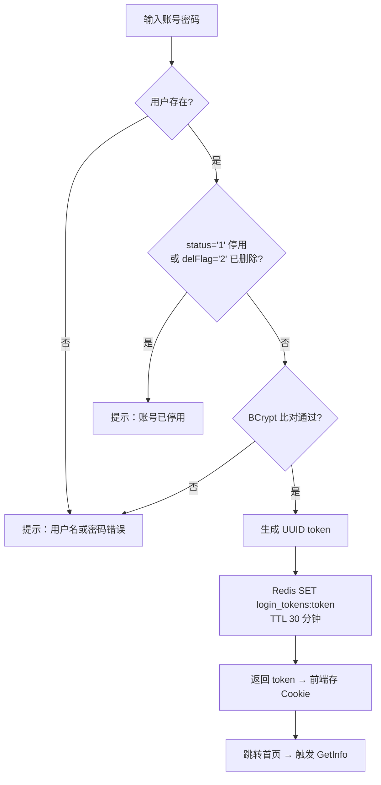

**时序图**

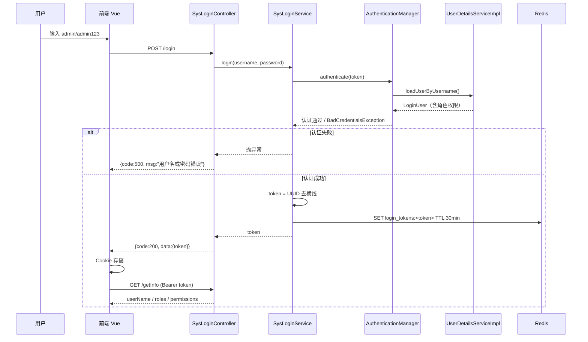

**接口**：见 5.3.1。

**处理规则与边界**：当前**未启用图形验证码**（需求 8.2 明确边界）；Redis 不可用时登录必失败（`RedisCache` 的 token 三方法不降级）；token TTL 30 分钟，每次请求续期。

### 6.2 患者管理模块（FR-3.2 / AC-02）

**模块描述**：维护患者档案，含姓名、性别、身份证、手机号、过敏史、既往史等。

**功能**：建档、查询、修改、删除、导出；身份证唯一性校验；身份证与手机号格式校验；诊疗/随访历史弹窗；一键跳转风险预测。

**输入项**

| 名称 | 类型 | 校验 | 说明 |
|------|------|------|------|
| `patientName` | String | 必填 | 姓名 |
| `gender` | String(1) | 枚举 0/1/2 | 性别 |
| `birthDate` | Date | — | 出生日期 |
| `idCard` | String(18) | `@Pattern` 18 位 | 身份证（可空） |
| `phone` | String(11) | `@Pattern` `1[3-9]\d{9}` | 手机号 |
| `allergyHistory` | String(500) | — | 过敏史（过敏校验真相源） |
| `pastHistory` | String(500) | — | 既往史 |

**输出项**：患者列表（`rows/total`）、详情、导出文件、校验错误提示。

**业务流程图**

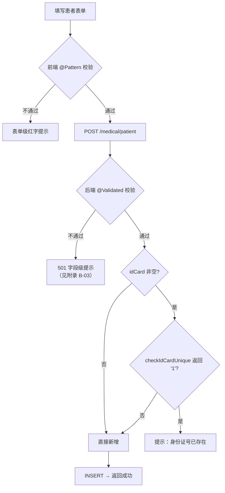

**接口**：见 5.3.2。

**处理规则与边界**：身份证为空时跳过唯一性校验（允许无证件建档）；列表支持按 `beginXxx/endXxx` 时间范围查询（因 `BaseEntity` 无 `params`）。

### 6.3 排班管理模块（FR-3.10 / AC-09）

**模块描述**：维护医生出诊排班与号源额度，供挂号选择。

**功能**：排班 CRUD；号源 `total_num` / `used_num` 维护；按日期过滤。

**输入项**：`dept`、`doctorName`、`scheduleDate`、`period`、`totalNum`、`status`。
**输出项**：排班列表（日期格式化 `yyyy-MM-dd`）、可选号源下拉（挂号页消费）。

**处理规则与边界**：`uk_sched` 唯一约束防重复排班；过期排班前端显示"已过诊"且不可选；排班模块**不执行号源占用**（该动作归挂号模块）。

### 6.4 挂号管理模块（FR-3.3 / AC-03、AC-04）

**模块描述**：患者挂号占用号源；支持退号释放号源；支持"开始就诊"生成诊疗草稿。

**功能**：生成 `GH+yyyyMMdd+4位随机` 单号；原子占号源；退号；开始就诊。

**输入项**

| 名称 | 类型 | 必填 | 说明 |
|------|------|------|------|
| `patientId` | Long | 是 | 患者ID |
| `scheduleId` | Long | 否 | 排班ID（为空则不占号源） |
| `dept` / `doctorName` | String | 就诊时必填 | 科室 / 医生 |
| `regType` | String(1) | 否 | 0普通 1专家 2急诊 |
| `regFee` | BigDecimal | 否 | 挂号费 |

**输出项**：挂号单（含 `regNo`、`regStatus`）；`start-visit` 返回新的 `diagnosisId`。

**业务流程图**

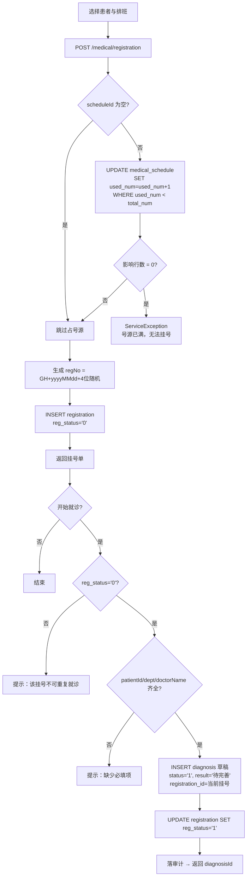

**状态流转图**

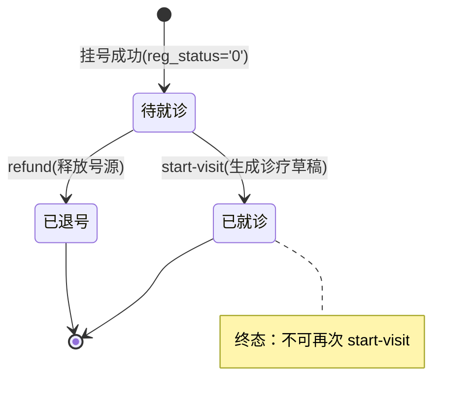

**时序图（挂号 + 开始就诊）**

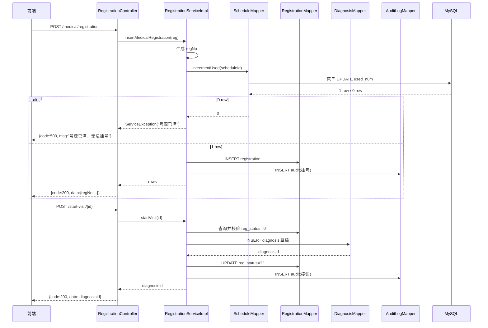

**接口**：见 5.3.4。

### 6.5 诊疗管理模块（FR-3.4 / AC-08）

**模块描述**：记录主诉、现病史、诊断结果、治疗方案与费用；支持 AI 辅助写病历并回填。

**功能**：CRUD；按患者查询；`fee-summary` 费用汇总（总数/总额/均值）；AI 病历生成回填。

**输入项**：`patientId`、`visitDate`、`department`、`doctorName`、`chiefComplaint`、`presentIllness`、`diagnosisResult`（必填）、`treatmentPlan`、`cost`、`status`。

**输出项**：诊疗列表/详情；`fee-summary` 汇总对象；AI 生成的病历草稿。

**处理规则与边界**：

- **主键分配（V1.0 已改为原子实现）**：新增时若 `diagnosisId` 为空，走 `IMedicalIdAllocatorService.allocateDiagnosisId()`。取值语义**仍是 `MAX(diagnosis_id)+1`**，因此删除记录后新记录可复用被删 ID（AC-08 不变）；原子性由 `medical_id_allocator` 行锁保证。

  调用链与关键约束：

  ```
  insertMedicalDiagnosis()                       @Transactional（必需）
     └─ idAllocatorService.allocateDiagnosisId()  @Transactional(REQUIRED)
           ├─ SELECT ... FROM medical_id_allocator WHERE biz_key='diagnosis' FOR UPDATE   ← 串行化
           ├─ SELECT diagnosis_id FROM medical_diagnosis ORDER BY diagnosis_id DESC LIMIT 1 FOR UPDATE  ← 当前读
           ├─ nextId = max + 1（空表时为 1）
           └─ UPDATE medical_id_allocator SET last_id = nextId                              ← 仅记账
  ```

  | 决策 | 依据 |
  |------|------|
  | 分配器用 `Propagation.REQUIRED`（加入调用方事务）而非 `REQUIRES_NEW` | 若走独立新事务，行锁会在"取号"提交时立刻释放，而调用方的 `INSERT` 尚未提交；此时另一事务抢到锁仍会读到同一个 MAX 值，照样撞主键。**必须让锁持有到 INSERT 提交** |
  | 最大值用 `ORDER BY ... LIMIT 1 FOR UPDATE` 的**当前读** | MySQL 默认 REPEATABLE READ 下普通 `SELECT MAX()` 走 MVCC 快照，可能读到事务开启时的旧值；加锁读绕过快照直读最新已提交版本 |
  | `last_id` 只记账不参与计算 | 一旦用它做递增计数器，"删除后复用"语义立即失效 |
  | 分配器放在**独立 Service** 而非本类私有方法 | Spring 声明式事务依赖代理，同类内部自调用会使 `@Transactional` 失效 |

- 调用方已显式指定 `diagnosisId` 时不重复分配（保留手工指定能力，如数据修复场景）。
- AI 辅助：按患者 ID 自动带出姓名/年龄/性别/过敏史；Ollama 不可用降级模板草稿。
- 患者不存在时提示"患者 ID x 不存在"。

**接口**：见 5.3.7。

### 6.6 药品管理模块（FR-3.5 / AC-10）

**模块描述**：维护药品目录、库存、生产日期与有效期，提供低库存与近效期预警。

**功能**：CRUD；`low-stock`（默认阈值 10）；`near-expiry`（默认 90 天）；剩余天数计算。

**输入项**：`drugName`、`drugCode`、`category`、`spec`、`manufacturer`、`unit`、`purchasePrice`、`salePrice`、`stock`、`productionDate`、`expiryDate`、`status`。

**输出项**：药品列表；预警列表（含 `daysLeft`）。

**处理规则与边界**：

- 剩余天数：未过期显示"N 天"；**已过期显示红色"-N 天（已过期）"**（需求 3.5 明确要求，且修复过 NaN 问题）。
- 种子数据**仅"板蓝根颗粒"故意设为过期**（`2025-08-31`），用于演示发药拦截场景；其余药品效期已统一改到 2027–2028，避免主流程被全量拦截。
- **阈值口径不一致**：`/low-stock` 与定时任务默认 10，统计看板硬编码 50 —— 见附录 B-07。

### 6.7 价目管理模块（FR-3.9）

**模块描述**：维护诊疗项目价目表，供处方开方时自动计价引用。

**功能**：CRUD；按 `item_type='药品' AND item_name=?` 供开方匹配单价。

**处理规则与边界**：价目缺失时开方取药品售价兜底（不报错）；修改价目不影响历史处方金额（历史订单金额为开方时快照）。

### 6.8 处方与发药模块（FR-3.6 / AC-05、AC-06、AC-07）

**模块描述**：开方（自动计价 + 过敏校验）→ 发药（效期/库存校验 + 原子扣减 + 流水）→ 退药（幂等回滚）。业务闭环核心。

**功能**：开方生成 `CF` 单号；按价目表计价；过敏警示；分次发药；退药回滚；作废；明细查询。

**输入项 / 输出项**：见 5.3.5。

**业务流程图（开方 → 发药 → 退药）**

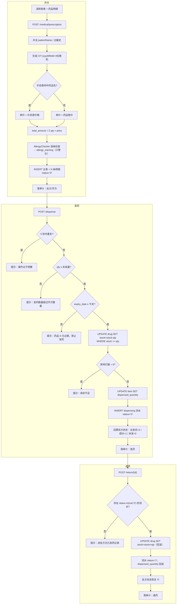

**状态流转图**

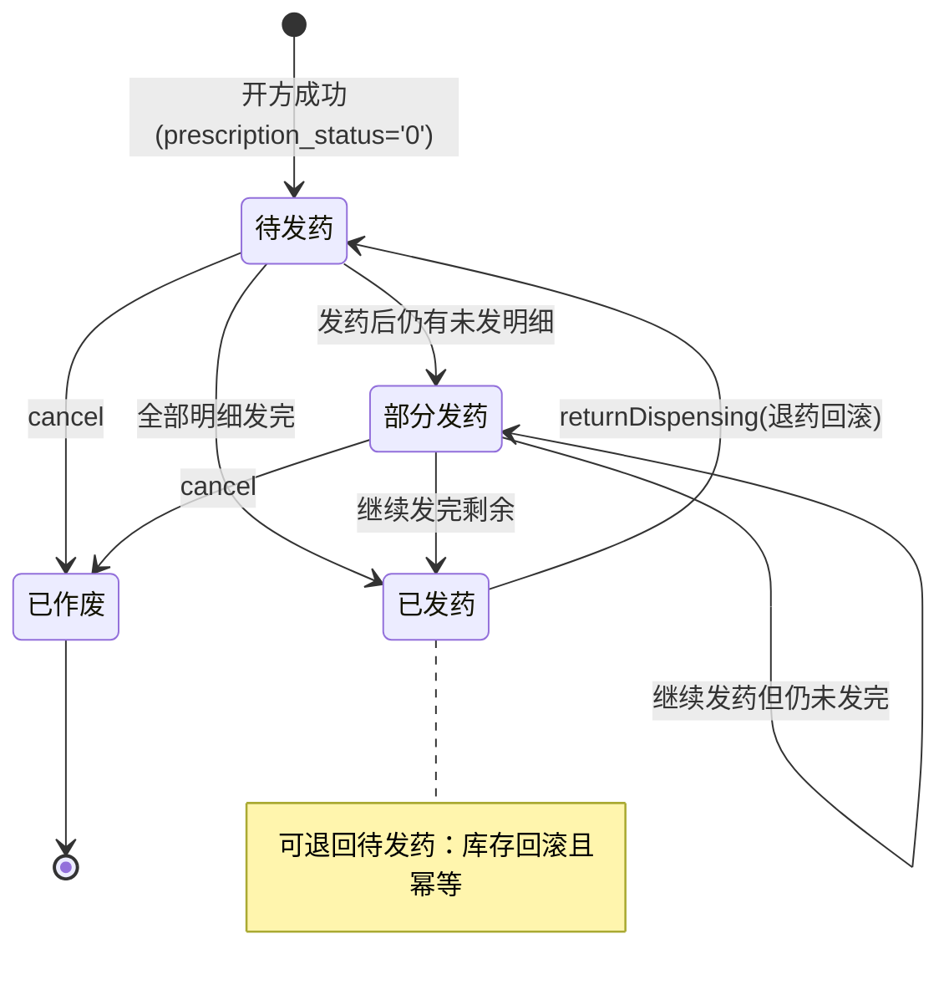

**时序图（发药，含并发保护）**

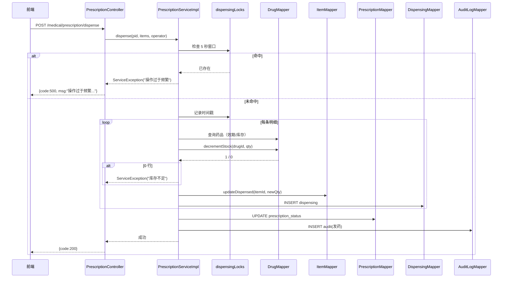

**接口**：见 5.3.5。

### 6.9 随访管理模块（FR-3.7）

**模块描述**：制定随访计划、记录随访结果。
**输入项**：`patientId`、`followupDate`、`followupType`（0电话 1微信 2上门）、`content`、`nextFollowupDate`、`status`、`followupPerson`。
**输出项**：随访列表；过期行高亮。
**处理规则**：关联患者；`next_followup_date` 过期行前端用 `tableRowClassName` + `::v-deep` 高亮。

### 6.10 站内信模块（FR-3.8）

**模块描述**：消息列表、已读标记、未读统计。
**输入项**：`receiver`（**登录用户名**）、`type`、`relatedId`。
**输出项**：消息列表、未读数（`data` 为数字本身，前端直接展示）。

**时序图（未读统计与已读）**

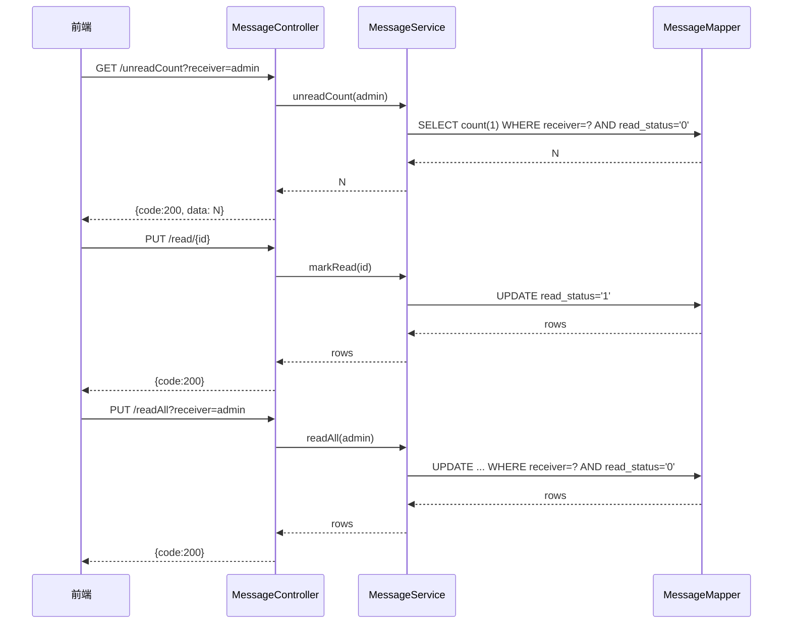

**处理规则**：`readAll` 的 SQL 带 `read_status='0'` 条件，天然幂等；推送去重依赖 `existsUnreadByTypeAndRelated`。

### 6.11 审计日志模块（FR-3.11 / AC-16）

**模块描述**：只读查询关键操作留痕。
**输入项**：`module`、`action`、`operator`、`beginTime`、`endTime`、分页参数。
**输出项**：审计列表；`count`。
**处理规则**：由业务动作自动写入，无写入接口；写入失败不影响主流程（try-catch 吞异常）。

**性能约束**：`/medical/audit/count` 当前实现为 `selectMedicalAuditLogList(new MedicalAuditLog()).size()` —— 全表捞取后取 size。审计表年增约 40 万行，该实现将造成较大内存开销，影响查询性能。修复方案见附录 B-05。

### 6.12 统计看板模块（FR-3.12 / AC-15）

**模块描述**：聚合运营指标，一次请求返回全部指标。
**输入项**：`refresh`（Boolean，可选，`true` 强制重算）。
**输出项**（13 项）：

| Key | 含义 | 来源 SQL |
|-----|------|----------|
| `patientTotal` | 患者总数 | `count(*) from medical_patient` |
| `diagnosisTotal` | 诊疗总数 | `count(*) from medical_diagnosis` |
| `drugTotal` | 药品总数 | `count(*) from medical_drug` |
| `registrationTotal` | 挂号总数 | `count(*) from medical_registration` |
| `prescriptionTotal` | 处方总数 | `count(*) from medical_prescription` |
| `dispensingTotalQty` | 发药总量 | `sum(quantity) from medical_dispensing` |
| `lowStockCount` | 库存预警数 | `count(*) where status!='1' and stock<=50` |
| `byDepartment` | 科室分布 | `group by department` |
| `byCategory` | 药品分类分布 | `group by category` |
| `costByDepartment` | 科室费用 | `sum(cost) group by department` |
| `costTrend` | 费用趋势（按月） | `DATE_FORMAT(visit_date,'%Y-%m')` |
| `genderStats` | 性别分布 | `group by gender` |
| `ageStats` | 年龄分布（5 档） | `TIMESTAMPDIFF(YEAR, birth_date, CURDATE())` |

**缓存策略**：JVM `static Map` + `AtomicLong cacheTs`，TTL 1 小时。

> **决策依据（见 D-04）**：统计结果变更频率低，进程内缓存可避免为演示环境引入缓存一致性治理成本。**代价**：多实例部署时各实例数据不一致。**取舍**：单实例部署为本项目的已知前提，已在 10.4 记录。若未来多实例，改为 Redis 缓存仅需替换 `cache` 的读写实现，接口契约不变。

### 6.13 定时任务模块（FR-3.13）

**模块描述**：可视化调度后台任务。
**功能**：任务 CRUD、启停、立即执行、Cron 校验、日志查看与清理。
**已实现业务任务**：

| Bean | 方法 | 作用 |
|------|------|------|
| `medicalRemindTask` | `scanLowStock(params)` | 扫描低库存药品（默认阈值 10，可由参数覆盖），按药品去重（存在未读则不重推），推送站内信给 `admin` |
| `followupRemindTask` | 随访提醒 | 随访逾期提醒 |
| `ryTask` | 若依示例任务 | 保留 |

**处理规则**：业务任务 `job_id` 从 **100** 起（1/2/3 被系统占用）；任务类通过 `SpringUtils.getBean()` 获取 Service，避免在 task 中直接注入。

### 6.14 AI 智能模块（FR-3.14 / AC-11 ~ AC-14）

**模块描述**：后端 8080 → FastAPI 8000 → Ollama / 本地模型 / Chroma。Java 侧 `AiHttpUtil` + `MedicalAiController`（18 端点），前端 5 页。

#### 6.14.1 病历生成（FR-3.14.1 / AC-11）

**输入项**：`patientId`（自动带出姓名/年龄/性别/过敏史）、`chiefComplaint`（必填）、`patientName`（必填）。
**输出项**：四段式结构化病历（主诉 / 现病史 / 初步诊断 / 医嘱）；`engine`、`model`、`degraded`、`elapsed_ms`。
**处理规则**：Ollama 实时生成约 40–52 秒；健康检查失败时降级为模板草稿（`fallback.py` 5 套关键词模板：呼吸道/消化道/高血压/糖尿病/外伤）。

#### 6.14.2 疾病风险预测（FR-3.14.2 / AC-12）

**输入项**：8 项临床特征数组（顺序见 5.3.6）。
**输出项**：`risk_prob`、`result_label`、`risk_level`、`advice`、`threshold`、`model_metrics`。
**处理规则**：特征数量不符报错；阈值 0.5；`<0.3` 低风险，`<0.6` 中风险，≥0.6 高风险。

#### 6.14.3 胸片识别（FR-3.14.3 / AC-13）

**输入项**：图片文件（multipart，≤10MB，校验 MIME 与扩展名）、`patientId`（可选）。
**输出项**：`predict_result`、`confidence`、`probs`（三类）、`img_url`、`device`、`elapsed_ms`。
**处理规则**：ResNet18，输入 224×224，ImageNet 归一化（`mean=[0.485,0.456,0.406]`，`std=[0.229,0.224,0.225]`）——**训练与推理必须一致**；类别顺序以 `models/chest_classes.json` 为准。

#### 6.14.4 智能导诊（FR-3.14.4 / AC-14）

**输入项**：`question`、`top_k`（默认 3），可选 `session_id`。
**输出项**：`answer`、`sources[]`、`engine`、`degraded`。
**处理规则**：Chroma cosine 距离检索 → `distance < 0.55` 过滤 → 过滤后为空**直接拒答**（不调 LLM）。

**时序图（RAG 问答，含拒答分支）**

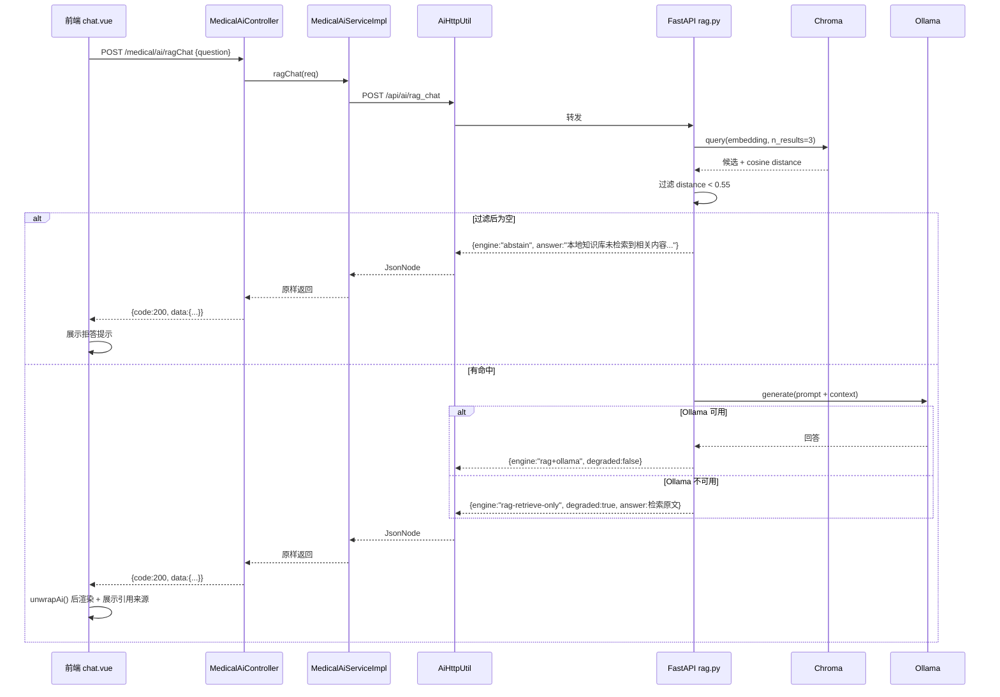

> **决策依据（拒答阈值 0.55）**：阈值设为"过滤后为空才拒答"，而非"最高分低于阈值就拒答"。理由：cosine 距离下不同主题的得分分布差异大，按最高分判定容易误拒；按"是否有任何一条过线"判定更稳。**备选方案**：调高阈值至 0.7（更严格，漏答增多）/ 调低至 0.4（召回增多，幻觉风险上升）。**取舍**：0.55 是实测（`doc/RAG检索质量对比实验.md`）后选定的平衡点。>  修正：此前记为"在 10 条知识库上实测"有误——10 条是 `scripts/build_rag_db.py` 内置的种子数量，而当前库 `medical_rag_knowledge` 实为 **18 条**（可在知识库页增补）。阈值结论本身不受影响。

---

## 7 业务流程与页面原型逻辑

### 7.1 端到端主流程（门诊一日）

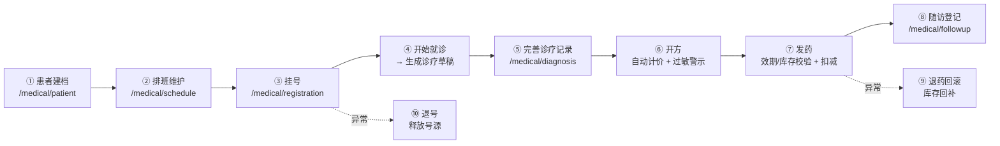

### 7.2 页面跳转与状态流转规则总表

| 起点页 | 触发动作 | 目标页 / 结果 | 状态变化 | 前端守卫 |
|--------|----------|---------------|----------|----------|
| 患者列表 | 「新增」 | 患者表单弹窗 | — | el-dialog 懒渲染守卫（部分页面缺失，见附录 B-14） |
| 患者列表 | 「风险预测」 | `/medical/ai-risk?patientId&age&gender` | — | 带入患者参数 |
| 患者列表 | 「诊疗历史」 | 弹窗表格 | — | 调 `listDiagnosisByPatientId` |
| 挂号列表 | 「新增」 | 挂号表单弹窗 | — | 号源下拉只列今天及以后 |
| 挂号列表 | 「开始就诊」 | 无跳转，提示并刷新 | `reg_status 0→1`，生成诊疗草稿 | **按钮按 `reg_status` 置灰**（仅 '0' 可点） |
| 挂号列表 | 「退号」 | 确认后刷新 | `reg_status →2`，号源释放 | 二次确认 |
| 处方列表 | 「开方」 | 处方表单弹窗（含明细行） | — | 动态增删药品行；选药自动带规格/售价 |
| 处方列表 | 「发药」 | 发药弹窗（按剩余量） | 处方 `0→1/2`，库存扣减 | 5 秒防重（后端），前端按钮 loading |
| 处方列表 | 「退药」 | 确认后刷新 | 处方 →0，库存回滚 | 二次确认；幂等 |
| 处方列表 | 「作废」 | 确认后刷新 | 处方 →3 | 二次确认 |
| 诊疗列表 | 「AI 生成」 | 回填表单字段 | — | `handleAiGenerate()` + `parseSection()` |
| AI 病历页 | 「保存」 | 落库并刷新历史表 | `status 0/1` | `ai_content` 与 `doctor_content` 分列 |
| 知识库页 | 「同步到向量库」 | 提示同步条数 | `synced 0→1` | 180s 超时 |
| 全局 | token 失效 | 跳 `/login` | — | **当前由 B-01 兜底，见附录 B-01** |

### 7.3 前后端交互时序（完整业务闭环）

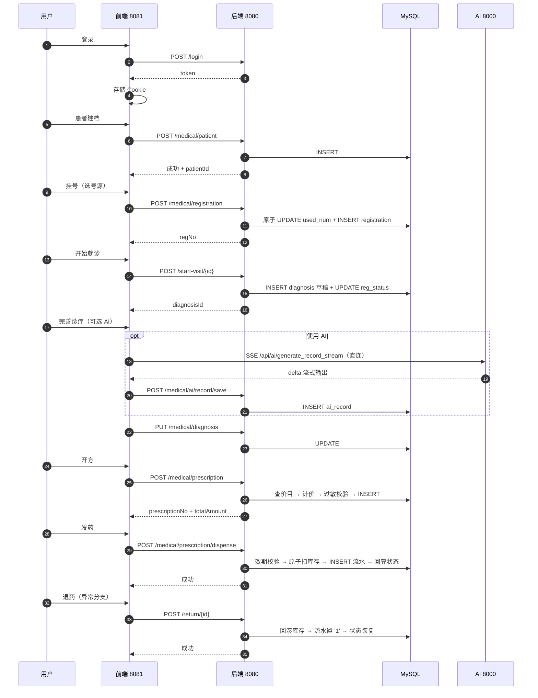

---

## 8 异常处理

### 8.1 异常分类

| 类别 | 代表异常 | 处理方式 | 响应 |
|------|----------|----------|------|
| 业务异常 | `ServiceException` | `GlobalExceptionHandler` 捕获，**透传 `message`** | `code:500, msg:可读中文` |
| 参数绑定异常 | `BindException` | 取第一条 `defaultMessage` | `code:500` |
| 参数校验异常 | `MethodArgumentNotValidException` | **当前未捕获**（落 Exception 分支） | `code:500, msg:"系统繁忙"`  |
| AI 服务异常 | `AiHttpUtil.AiServiceException` | Controller 逐端点 catch → `AjaxResult.error(msg)` | `code:500, msg:AI 侧原因` |
| 运行时异常 | `RuntimeException` | 统一转为"系统内部错误，请联系管理员" | `code:500` |
| 兜底 | `Exception` | "系统繁忙，请稍后重试" | `code:500` |
| 未认证 | 无 token / token 失效 | `AuthenticationEntryPointImpl` | 401 |

> **强制约定**：业务失败**必须抛 `ServiceException`**，禁止抛 `RuntimeException`（会被吞成"系统内部错误"，丢失可读原因）。

### 8.2 捕获与重试机制

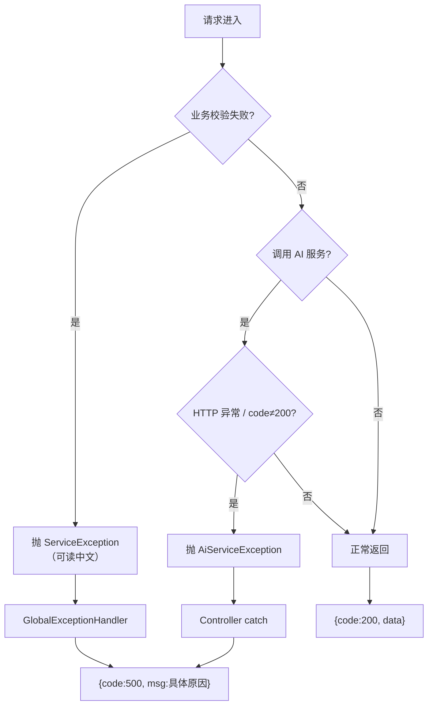

**重试策略：**

| 场景 | 是否重试 | 说明 |
|------|----------|------|
| 数据库原子更新返回 0 行 | **否** | 属业务冲突（库存不足/号源已满），重试无意义，直接报可读错误 |
| AI 服务连接失败 | **否**（前端可手动重试） | 130s 超时已较长，自动重试会放大等待；前端提供重试按钮 |
| Ollama 健康检查失败 | **否**，走降级 | 立即降级为模板，不等超时 |
| Redis 业务缓存失败 | **否**，走 `safe()` 兜底 | 返回兜底值 + 一次 WARN |
| Redis 会话操作失败 | **否**，异常上抛 | 鉴权不允许降级，否则会产生"未认证放行" |

> **决策依据**：本系统**不做自动重试**。理由：医疗业务的写操作（扣库存、占号源）失败多数是业务冲突而非瞬时故障，重试只会让用户更困惑；且自动重试在"发药"这类动作上有重复扣减风险（虽有 5 秒锁，但锁过期后重试仍可能重复）。**取舍**：把重试决策交回用户（前端按钮），后端只保证单次调用的原子性与幂等性。

### 8.3 日志与告警策略

| 层 | 日志位置 | 级别约定 | 关键内容 |
|----|----------|----------|----------|
| 后端 | `logs/ruoyi-medical.log`（按大小+时间滚动） | `com.ruoyi: info`、`org.springframework: warn` | 业务动作、审计失败、AI 调用耗时 |
| AI 服务 | 控制台 / uvicorn 日志 | INFO | 模块加载、降级标记 `degraded`、推理耗时 |
| 前端 | 浏览器控制台 | — | 请求错误、401 |
| 定时任务 | 后端日志 | INFO | `【定时任务】低库存扫描（阈值 X）：命中 N 个药品` |

**必须打日志的六个点位：**

1. AI 调用：目标端点、耗时、`degraded` 标记。
2. 审计写入失败：`audit()` 的 catch 分支（吞异常时必须留痕）。
3. 库存/号源原子更新返回 0 行：记录业务单号与请求量。
4. 定时任务：扫描阈值与命中数。
5. Redis 降级：`RedisCache.safe()` 的 WARN（每个 key 仅一次）。
6. 登录失败：用户名（**不记密码**）。

**告警**：演示/教学环境不接告警平台，以日志 + 前端提示为准。若上生产，建议对"AI 服务连续不可用""审计写入连续失败""库存不足频次突增"配置阈值告警。

### 8.4 降级方案

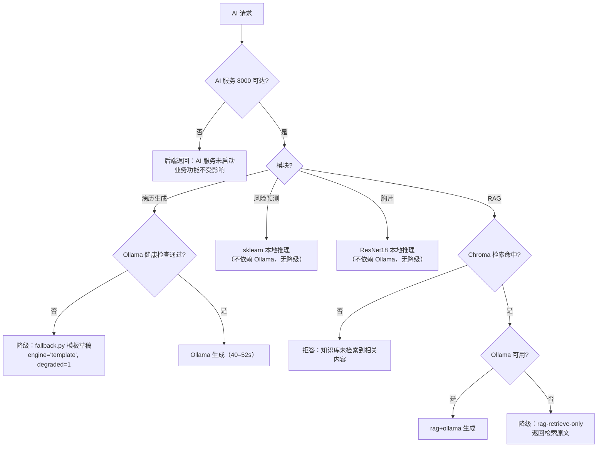

| 依赖 | 降级路径 | 用户可见提示 |
|------|----------|--------------|
| AI 服务 8000 整体不可用 | 业务功能正常，AI 端点报错 | "AI 服务未启动，请检查 8000 端口" |
| Ollama 11434 不可用（病历） | 5 套关键词模板草稿 | 顶部 `el-alert` 显示 `llmReady=false` 与原因 |
| Ollama 不可用（RAG） | 返回检索原文 | `engine=rag-retrieve-only`，提示"大模型未就绪，仅返回知识库原文" |
| 知识库未命中 | 固定拒答话术 | "本地知识库未检索到相关内容……建议前往医院相应科室就诊" |
| Redis 不可用（业务缓存） | `safe()` 返回兜底值 | 无感知 |
| Redis 不可用（会话） | **不降级**，登录失败 | 需启动 Memurai |

---

## 9 开发约束与规范

### 9.1 编码约束（违反会导致编译失败或运行时错误）

| # | 约束 | 原因 |
|---|------|------|
| 1 | Mapper XML **禁止**写 `params.beginTime` | `BaseEntity` 无 `params` 字段；改用实体显式 `beginXxx/endXxx` |
| 2 | 业务 Controller **禁止**使用 `@PreAuthorize` / `@Log` / `BusinessType` | 类不存在于裁剪版，编译报"找不到符号" |
| 3 | `ruoyi-system` 中**禁止**使用 `SecurityUtils` | 依赖方向反转（2.4）；改用 `SecurityContextHolder` |
| 4 | 业务失败**必须**抛 `ServiceException` | 抛 `RuntimeException` 会被吞成"系统内部错误" |
| 5 | Vue `methods` **禁止**定义名为 `resetForm` 的方法 | 遮蔽全局 `Vue.prototype.resetForm` → 无限递归；改名 `handleReset` |
| 6 | Vue2 **禁止**使用 `:deep()` | 不支持；用 `::v-deep` 或内联 style |
| 7 | `mybatis.mapper-locations` 必须是 `classpath*:mapper/**/*.xml` | 只写 `classpath:` 在 fat jar 下会漏加载依赖 jar 的 XML |
| 8 | `type-aliases-package` 必须列全 domain 包 | 漏了会因找不到别名导致启动失败 |
| 9 | 菜单 SQL 必须幂等 | 裸 INSERT 会重复；`LAST_INSERT_ID()` 残留会挂错父菜单 |
| 10 | 前端构建用 `npm run build:prod` | **没有 `build` 脚本** |
| 11 | AI 接口取值必须过 `unwrapAi()` | Java 未拆 Python 信封，双层包装 |
| 12 | 导入 SQL 必须带 `--default-character-set=utf8mb4` | 否则中文乱码 |
| 13 | MySQL 迁移脚本禁止 `ADD COLUMN IF NOT EXISTS` | MySQL 8 不支持 |
| 14 | 后端 jar 运行时**禁止**重打包 | 文件占用会导致打包失败；先停再打 |
| 15 | 禁止使用 `mvn spring-boot:run` 启动 | 本项目启动方式固定为 `java -jar` + `--server.port=8080` |

### 9.2 提交前必跑的体检脚本

| 脚本 | 作用 | 位置 |
|------|------|------|
| `check_mapper.py` | 核对 Mapper 接口方法与 XML 语句一一对应 | `.workbuddy/check_mapper.py` |
| `check_schema.py` | 核对表列与实体字段一致（**可发现 4.4.15 那类缺口**） | `.workbuddy/check_schema.py` |
| `check_vue.py` | 核对 Vue 模板中调用的方法、`$refs`、`v-model` 均已定义 | `.workbuddy/check_vue.py` |
| `e2e_smoke.py` | 真实 HTTP 主链路冒烟 | `.workbuddy/e2e_smoke.py` |
| `concurrency_test.py` | 并发场景（占号源、扣库存） | `.workbuddy/concurrency_test.py` |

> 这些脚本均从 `application.yml` 读取连接信息，**不硬编码密码**。

### 9.3 命名与代码风格

| 项 | 规范 |
|----|------|
| 后端包 | `com.ruoyi.system.domain|mapper|service|utils`、`com.ruoyi.controller`、`com.ruoyi.framework.*`、`com.ruoyi.common.*` |
| 实体 | `MedicalXxx`，字段驼峰，表列下划线（靠 `map-underscore-to-camel-case`） |
| Service | 接口 `IXxxService`，实现 `XxxServiceImpl` |
| 单号 | 挂号 `GH+yyyyMMdd+4位随机`；处方 `CF+yyyyMMdd+4位随机` |
| 状态字段 | `CHAR(1)` 字符串枚举，含义写进列注释与实体注释 |
| 前端路由 | `/medical/<模块>`，name 用大驼峰 |
| API 文件 | `src/api/medical/<模块>.js`，函数名 `list/get/add/update/del + 模块` |

---

## 10 性能指标

### 10.1 指标定义

| 类别 | 指标 | 目标值 | 测量方式 |
|------|------|--------|----------|
| 响应时间 | 常规列表查询（分页 10 条） | P95 ≤ 500ms，硬上限 3s（需求 4.1） | 浏览器 Network / 后端日志 |
| 响应时间 | 单条详情查询 | P95 ≤ 200ms | 同上 |
| 响应时间 | 写操作（开方、发药、退号） | P95 ≤ 800ms | 同上 |
| 响应时间 | 导出（1000 行内） | ≤ 3s | 同上 |
| 响应时间 | AI 病历生成 | 40–52s（需求允许 40–60s，须有进度提示） | 前端计时 |
| 响应时间 | AI 风险预测 / 胸片 | ≤ 5s（本地模型推理，不含模型冷加载） | `elapsed_ms` 字段 |
| 响应时间 | AI RAG 问答 | ≤ 20s（检索约 1s + LLM 生成） | 同上 |
| 并发量 | 在线用户 | ≥ 50（单机构门诊规模） | — |
| 并发量 | 挂号并发（同一号源） | ≥ 20 并发不超卖 | `concurrency_test.py` |
| 并发量 | 发药并发（同一药品） | ≥ 20 并发不超卖 | 同上 |
| 吞吐量 | 业务读请求 | ≥ 100 QPS | Druid 监控 |
| 吞吐量 | 业务写请求 | ≥ 30 TPS | 同上 |
| 资源 | 后端 JVM 堆 | 建议 `-Xms512m -Xmx1024m` | — |
| 资源 | AI 服务内存 | ≥ 2GB（embedding 模型约 500MB + PyTorch） | — |

### 10.2 性能保障措施

| 措施 | 位置 | 说明 |
|------|------|------|
| 条件原子 SQL | `MedicalDrugMapper.xml`、`MedicalScheduleMapper.xml` | 避免行锁与分布式锁开销 |
| Druid 连接池 | `application.yml` | `initial-size:10`、`max-active:200`、`validation-query: SELECT 1 FROM DUAL` |
| 统计结果缓存 | `MedicalStatisticsServiceImpl` | JVM Map，TTL 1 小时，避免每次看板请求全表聚合 |
| 索引覆盖 | 见 4.5 | 高频查询路径均有索引 |
| 前端 chunk 拆分 | `vue.config.js` | element-ui / vendors 独立 chunk，业务更新可复用缓存 |
| 模型懒加载 | `risk.py` / `chest.py` / `rag.py` | 首次请求才加载，避免启动即占内存 |
| 分页默认 10 条 | 各 Controller | `pageNum=1, pageSize=10` |

### 10.3 性能风险与已识别瓶颈

| 风险 | 影响 | 缓解 |
|------|------|------|
| `/medical/audit/count` 全表捞取 | 审计表增长后 OOM | 改为 `COUNT(1)`（附录 B-04） |
| 统计看板未缓存时全表聚合 | 首次请求慢 | 已有 1 小时缓存；`refresh=true` 仅在必要时使用 |
| AI 首次推理含模型冷加载 | 首次可达 2 分钟 | 启动预热线程（`llm.py` 的 `warmup`）+ `OLLAMA_KEEP_ALIVE=30m` |
| 前端 Element UI 全量引入 | 包体约 1.2MB | 已做 chunk 拆分；后续可改按需引入 |

### 10.4 已知限制（须在评审时声明）

1. **统计缓存为进程内缓存**（单例 Bean 的 `ConcurrentHashMap`，TTL 1 小时），多实例部署时各实例结果可能不一致，应用重启即失效；接口已提供 `refresh=true` 强制重算。
2. **发药防重锁为单机内存锁**（`ConcurrentHashMap`），多实例部署失效，且 Map 无清理逻辑会缓慢增长。
3. **诊疗 ID 分配依赖数据库行锁串行化**，取号吞吐受单行锁约束（约等于单线程）。诊疗新增属低频写操作，实测无影响；若未来门诊量级上升，可改为号段预分配（一次取 N 个 ID 缓存在内存）。
4. **未做限流**，异常流量可能穿透到数据库。
5. **统计缓存的返回值是快照副本**，调用方修改返回值不会影响缓存（这是 V1.0 的加固项，此前返回的是缓存对象本身，存在被外部污染的风险）。

---

## 11 安全规范

### 11.1 认证与鉴权

| 项 | 实现 | 位置 |
|----|------|------|
| 认证方式 | Spring Security + JWT（UUID token + Redis 会话），`STATELESS` | `SecurityConfig`、`JwtAuthenticationTokenFilter` |
| 密码存储 | BCrypt | `SecurityConfig` |
| 会话 | Redis `login_tokens:<token>`，TTL 30 分钟，每次请求续期 | `TokenService` |
| 放行清单 | `/login` `/logout` `/captchaImage` `/error` `/favicon.ico`；其余 `.anyRequest().authenticated()` | `SecurityConfig` |
| 授权粒度 | **仅到菜单级**（角色 → 菜单）；按钮级 `v-hasPermi` 当前恒返回 `true` | `directive/permission.js` |
| 超级管理员 | 角色含 `admin` 时权限直接为 `*:*:*` | `UserDetailsServiceImpl` |
| CSRF | 已关闭（`STATELESS` + token 在 Header，非 Cookie 自动携带） | `SecurityConfig` |
| CORS | 后端 `/**` 全放行 `allowedOriginPatterns("*")`；AI 侧 `allow_origins=["*"]` | `CorsConfig`、`main.py` |

> **授权缺口（须声明）**：按钮级鉴权当前是"全放行"实现。这意味着**未来接入真实按钮权限时，需要改前端指令（`hasPermission()` 的返回逻辑）而非只改后端**。已在需求 8.1 列为已知边界。

### 11.2 数据校验

| 层次 | 校验内容 | 实现 |
|------|----------|------|
| 前端 | 必填、格式（身份证/手机号同后端正则） | Element UI 表单 rules |
| 后端入参 | `@Validated @RequestBody` + `@Pattern` | `MedicalPatient`（身份证、手机号） |
| 业务规则 | 号源、库存、效期、状态机、过敏、数量上限 | Service 层 `ServiceException` |
| 数据层 | 原子 UPDATE 的 WHERE 条件（最后一道防线） | Mapper XML |

**原则**：**服务端校验是强制的，前端校验只是体验优化**。凡涉及金额、库存、效期的规则，必须在服务端强制拦截（需求 4.2）。

### 11.3 敏感信息保护

| 项 | 措施 |
|----|------|
| 密码 | BCrypt 存储；**不落响应**（`LoginUser` 不序列化密码字段） |
| 身份证 / 手机号 | 列表展示**脱敏**（前端处理）；服务端不额外加密（演示数据） |
| 患者数据 | 仅用于演示，**禁止入库真实身份信息**（需求 6.3 合规约束） |
| 数据库口令 | 已外部化为 `${DB_PASSWORD:<当前值>}`（`application.yml`）。保留默认值仅为向后兼容；**完成轮换后必须删除默认值**，见 11.3.1 |
| 胸片图片 | 存于 AI 侧 `data/uploads`，通过 `/ai-uploads` 静态暴露；删除记录时同步删物理文件（`deleteUpload` 含目录穿越校验） |
| AI 输出 | 页面与接口均标注"AI 结果仅供参考，不替代医生诊断" |

### 11.3.1 数据库口令轮换流程（需由运维/使用者执行）

口令轮换会**同时改动 MySQL 与环境变量**，顺序错了会直接让后端连不上库。配置已支持环境变量，故按下述顺序可在不中断的前提下完成：

```bash
# ① 先在 MySQL 侧改口令（后端暂不受影响，因为 application.yml 里有兼容默认值）
"D:/MySQL/Server80/bin/mysql.exe" -uroot -p -h127.0.0.1 -e "ALTER USER 'root'@'localhost' IDENTIFIED BY '<新口令>';"

# ② 设置环境变量（Windows 会话级；写入系统环境变量或用 start.bat 注入可实现持久化）
set DB_PASSWORD=<新口令>

# ③ 用新口令重启后端，并确认能正常登录、看板有数据
java -jar ruoyi-admin-1.0.0.jar --server.port=8080

# ④ 确认无误后，删除 application.yml 中的默认值，改为强制从环境变量读取
#    password: ${DB_PASSWORD}
```

| 注意点 | 说明 |
|--------|------|
| **① 与 ② 之间会有短暂不一致** | 若在此期间重启后端，会先用默认值连库；因 MySQL 口令已改，连接失败。故①之后应尽快完成②③，或先停后端再改 |
| 默认值必须最终删除 | 只做外部化而不删默认值，明文口令仍在仓库里，等于没轮换 |
| 历史提交仍含明文 | 轮换后如需彻底清除，须重写 Git 历史（`git filter-repo`），属高危操作，演示项目通常不必做 |
| 不要写在 `start.bat` | 把新口令写进脚本等于换了个明文位置；应在系统环境变量或部署平台的密钥管理中配置 |

### 11.4 上传安全（胸片）

| 措施 | 位置 |
|------|------|
| 大小限制 ≤ 10MB | `MedicalAiController.chestXray` |
| MIME 与扩展名校验 | `main.py` 上传处理段 |
| 文件名 UUID 化 | `main.py`（避免路径穿越与覆盖） |
| 删除时目录穿越校验 | `main.py: delete_upload` |

---

## 12 测试设计要点（对齐 AC）

| 验收项 | 用例要点 | 关键断言 | 关联设计章节 |
|--------|----------|----------|--------------|
| AC-01 登录 | 正确凭据 / 错误凭据 / 无 token 访问 | 返回 token；错误返回 401 或 500+可读 msg；无 token 401 | 6.1 |
| AC-02 患者建档 | 合法身份证 `110101199001010015` / 手机号 `13812345678`；非法各一 | 合法保存成功；非法被拦截且提示到字段 | 6.2 |
| AC-03 挂号闭环 | 正常挂号；把某排班 `used_num` 设为 `total_num` 后再挂 | 单号匹配 `^GH\d{8}\d{4}$`；`used_num+1`；满号报"号源已满" | 6.4 |
| AC-04 开始就诊 | 对 `reg_status='0'` 执行；重复执行 | 生成诊疗草稿且 `registration_id` 正确；挂号转 '1'；重复执行被拒 | 6.4 |
| AC-05 开方 | 开含价目药品的处方；开与患者过敏史冲突的药品 | `total_amount` = Σ 单价×数量；`allergy_warning` 非空；单号 `^CF\d{8}\d{4}$` | 6.8 |
| AC-06 发药 | 正常发药；对过期药（板蓝根颗粒）发药；库存不足发药 | 正常扣库存且状态流转；过期报"已过期…禁止发药"；不足报"库存不足" | 6.8 |
| AC-07 退药 | 退药一次；再退一次 | 第一次库存回补；第二次报"无已发药记录"（幂等） | 6.8 |
| AC-08 诊疗 ID | 删除某诊疗后新增 | 新记录 ID = 被删 ID（`MAX+1`） | 6.5 |
| AC-09 排班 | 查看过去排班；修改时选过去日期 | 显示"已过诊"；日期格式化 `yyyy-MM-dd`；过去日期不可选 | 6.3 |
| AC-10 近效期 | 查看过期药品 | 显示"-N 天（已过期）"，**无 NaN** | 6.6 |
| AC-11 AI 病历 | 有 Ollama / 无 Ollama 两种环境 | 均返回四段式草稿；无 Ollama 时 `engine='template'` 且 `degraded='1'` | 6.14.1 |
| AC-12 风险预测 | 传 8 项特征；传 7 项 | 返回 `risk_prob` 与 `risk_level`；数量不符报错 | 6.14.2 |
| AC-13 胸片 | 上传胸片 | 返回三分类之一 + `probs` 三个值；`probs_json` 落库成功（**需先执行 M3**） | 6.14.3、4.6.2 |
| AC-14 智能导诊 | 问库内问题；问库外问题（如"如何炖红烧肉"） | 库内返回答案 + 引用来源；库外固定拒答 | 6.14.4 |
| AC-15 统计看板 | 打开看板；传 `refresh=true` | 13 项指标非空且数值与单表统计一致 | 6.12 |
| AC-16 审计 | 依次执行开方、发药、退药、退号 | 四类动作均能在 `/medical/audit/list` 查到，`biz_no` 正确 | 6.11 |

**并发测试用例（对应 10.1）：**

| 场景 | 方法 | 期望 |
|------|------|------|
| 同一号源 20 并发挂号 | `concurrency_test.py` | 成功数 ≤ 剩余号源数，`used_num` 不超过 `total_num` |
| 同一药品 20 并发发药 | 同上 | 扣减总量 = 成功请求量之和，`stock` 不为负 |
| 同一处方 2 次快速发药 | 手工 / 脚本 5 秒内两次 | 第二次被"操作过于频繁"拦截 |

---

### 12.1 完整测试用例表（对齐 AC-01 ~ AC-20）

下列用例为《测试记录》（`doc/测试记录.md`）的摘录与汇总，覆盖核心业务闭环与四类 AI 能力，执行结论均已落库验证。

| 用例 ID | 测试场景 | 前置条件 | 操作步骤 | 预期结果 | 实际结果 | 是否通过 |
|---------|----------|----------|----------|----------|----------|----------|
| TC-01 | 管理员登录 | 后端 / Redis 已启动 | 输入 admin / admin123 登录 | 返回 token，进入首页 | 与预期一致 | 通过 |
| TC-02 | 患者建档（合法） | — | 录入身份证 `110101199001010015`、手机 `13812345678` | 保存成功，列表出现该记录 | 与预期一致 | 通过 |
| TC-03 | 患者建档（非法身份证） | — | 录入错误校验位身份证 | 后端 `@Pattern` 拦截，提示到字段 | 与预期一致 | 通过 |
| TC-04 | 正常挂号 | 存在未满号源排班 | 选择排班提交挂号 | 单号 `^GH\d{8}\d{4}$`，`used_num+1` | 与预期一致 | 通过 |
| TC-05 | 满号挂号拦截 | 将排班 `used_num` 置为 `total_num` | 再次挂号 | 报"号源已满"，`used_num` 不超上限 | 与预期一致 | 通过 |
| TC-06 | 开始就诊 | `reg_status='0'` 的挂号 | 点击开始就诊 | 生成诊疗草稿，`registration_id` 正确，挂号转 '1' | 与预期一致 | 通过 |
| TC-07 | 重复开始就诊 | 已就诊的挂号 | 再次点击开始就诊 | 被拒，提示已就诊 | 与预期一致 | 通过 |
| TC-08 | 开方自动计价 | 患者存在过敏史 | 开含价目表药品处方 | `total_amount`=Σ单价×数量；过敏命中给警示 | 与预期一致 | 通过 |
| TC-09 | 发药（正常） | 处方状态可发 | 提交发药 | 扣库存，状态流转为已发药 | 与预期一致 | 通过 |
| TC-10 | 发药（过期药拦截） | 板蓝根颗粒 `expiry_date` 已过期 | 对该药发药 | 报"已过期…禁止发药"，不扣库存 | 与预期一致 | 通过 |
| TC-11 | 发药（库存不足拦截） | 某药 `stock=0` | 对该药发药 | 报"库存不足" | 与预期一致 | 通过 |
| TC-12 | 退药幂等 | 已发药处方 | 退药一次，再退一次 | 第一次回补库存；第二次报"无已发药记录" | 与预期一致 | 通过 |
| TC-13 | 诊疗 ID 复用 | 删除某诊疗记录 | 新增诊疗 | 新 ID = 被删 ID（MAX+1） | 与预期一致 | 通过 |
| TC-14 | 排班过去日期不可选 | — | 修改排班选过去日期 | 日期控件禁用过去日期 | 与预期一致 | 通过 |
| TC-15 | 近效期无 NaN | 存在过期药品 | 打开药品列表 | 显示"-N 天（已过期）"，无 NaN | 与预期一致 | 通过 |
| TC-16 | AI 病历（有 Ollama） | Ollama 已 serve | 触发病历生成 | 返回四段式草稿，`engine='ollama'` | 与预期一致 | 通过 |
| TC-17 | AI 病历（无 Ollama 降级） | 停止 Ollama | 触发病历生成 | 返回模板草稿，`engine='template'`、`degraded='1'` | 与预期一致 | 通过 |
| TC-18 | 风险预测 | 传入 8 项特征 | 提交预测 | 返回 `risk_prob` 与 `risk_level` | 与预期一致 | 通过 |
| TC-19 | 胸片三分类 | 上传胸片（**需先执行 patch_v4 / M3**） | 提交胸片识别 | 返回三分类之一 + `probs_json` 落库 | 开发库已验证 | 通过 |
| TC-20 | 智能导诊拒答 | — | 问库外问题"如何炖红烧肉" | 固定拒答，不调用大模型 | 与预期一致 | 通过 |
| TC-21 | 统计看板一致性 | — | 打开看板 / 传 `refresh=true` | 13 项指标与单表统计一致 | 与预期一致 | 通过 |
| TC-22 | 审计留痕 | — | 依次开方/发药/退药/退号 | 四类动作均可在审计列表查到 | 与预期一致 | 通过 |
| TC-23 | 并发挂号 | 同一号源 20 并发 | `concurrency_test.py` | 成功数 ≤ 剩余号源，`used_num` 不超 `total_num` | 与预期一致 | 通过 |
| TC-24 | 并发发药 | 同一药品 20 并发 | `concurrency_test.py` | 扣减总量 = 成功量之和，`stock` 不为负 | 与预期一致 | 通过 |

> 说明：TC-19 依赖第 4 章 4.6.2 迁移脚本（patch_v4 胸片三分类）已对目标库执行；若目标库仍为二分类形态，需先执行 `sql/medical_patch_v4.sql`。

---

## 13 部署实施

本章给出从零到可运行的部署步骤、环境要求与启动后验证清单，与 `doc/部署说明.md`、`doc/AI模块部署说明.md` 互为补充。

### 13.1 软硬件环境要求

| 类别 | 最低要求 | 说明 |
|------|----------|------|
| 操作系统 | Windows 10/11 或 Linux | 演示与开发以 Windows 为主 |
| JDK | 8u（LTS） | 后端基于 Spring Boot 2.7 + RuoYi 裁剪 |
| Node | 16.x | 前端 `ruoyi-ui` 构建与 dev server |
| Python | 3.11（AI 服务） | `ruoyi-ai` 依赖 PyTorch / Chroma / sentence-transformers |
| MySQL | 8.0 | 库名 `ruoyi_medical`，导入脚本须带 `--default-character-set=utf8mb4` |
| Redis / Memurai | 任意近期版 | 仅存会话令牌，Windows 可用 Memurai 替代原生 Redis |
| **GPU（AI 推理，可选）** | NVIDIA RTX 4050 6GB 及以上 | 仅本地大模型 / 胸片推理需要；无 GPU 时 Ollama 走 CPU（慢）、胸片走 CPU 推理、RAG 仍可运行 |
| 磁盘 | 空闲 ≥ 10GB | 含模型文件（qwen2.5 4.7GB、chest_cnn.pth、embedding） |

> **无 GPU 声明**：AI 子系统在不具备独显的机器上**仍可部署与演示**——病历生成与 RAG 可降级（模板 / 拒答），胸片识别可切换 CPU 推理（时延升高但功能可用）。但完整的"本地大模型实时生成"体验需要 6GB 以上显存。

### 13.2 部署步骤（演示态，六进程一键拉起）

1. **启动基础服务**：`net start MySQL80`；启动 Memurai（`D:/Memurai/memurai.exe`）。
2. **初始化数据库**（首次）：按 `doc/部署说明.md` 顺序执行 `ry_20231130 → medical_schema → followup → message → price → quartz → menu → medical_clinic（含 patch v2/v3）` 等脚本；AI 相关表执行 `medical_ai` + `patch_v4`（胸片三分类）+ `patch_v5`（诊疗 ID 串行化）。
3. **启动后端**：`java -jar ruoyi-admin-1.0.0.jar --server.port=8080`（必须显式传 `--server.port=8080`，见 2.3 决策依据）。
4. **启动 AI 服务**：在 `ruoyi-ai` 目录 `uvicorn main:app --host 127.0.0.1 --port 8000`。
5. **（可选）启动 Ollama**：`ollama serve`，并确认已拉取 `qwen2.5:7b-instruct-q4_K_M`。
6. **启动前端**：`cd ruoyi-ui && npm install && npm run dev`（dev server :8081，含代理）。

> 上述步骤已封装为根目录 `start.bat`，双击即可按顺序拉起 MySQL → Memurai → 后端 → AI 服务 → 前端（跳过 `npm install` 若已装），适配答辩现场"一键演示"。
> **Ollama 不纳入自动启动**：该服务开机自启已关闭、`start.bat` 也不再拉起；需要大模型能力时手动执行 `ollama serve`，未启动时病历生成与导诊问答自动降级，不影响其余功能。

### 13.3 启动后验证清单

| 验证项 | 方法 | 通过标准 |
|--------|------|----------|
| 后端存活 | 浏览器访问 `http://localhost:8080` | 返回登录页或 401（未认证） |
| 登录可用 | 用 admin/admin123 登录 | 获取 token，菜单加载正常 |
| 看板有数据 | 打开统计看板 | 13 项指标非空（核心 4 项：挂号量 / 处方量 / 发药总量 / 库存预警） |
| AI 健康检查 | `GET http://localhost:8000/health` | 返回 `{"status":"ok"}`（模型未加载也不阻塞） |
| 胸片原图可访问 | 访问 `/ai-uploads/xxx.png` | 返回图片（前端 dev proxy 与 `main.py` 静态挂载须同时就位） |

### 13.4 配置外部化与口令

- 数据库口令已外部化为 `${DB_PASSWORD:<兼容默认值>}`，**真实口令不在仓库明文留存**；完成轮换后须删除 `application.yml` 中的默认值（流程见 11.3.1）。
- AI 服务地址、MySQL/Redis 主机均支持环境变量（`AI_SERVICE_URL` / `DB_HOST` / `REDIS_HOST` 等），容器化部署无需改代码（见 2.3.1）。
- 容器化部署（Docker Compose 五服务）提供 `docker-compose.yml`，首次部署请在装有 Docker 的主机执行 `docker compose up -d --build` 验证（沙箱未实测，见 B.2）。

---

## 附录 A 需求追溯矩阵（完整）

> **正向**：需求 → 设计 → 代码 → 验收。**反向**：由代码文件可反查需求来源。

| 需求编号 | 需求名称 | 设计章节 | 主要代码位置 | 关联表 | 验收项 |
|----------|----------|----------|--------------|--------|--------|
| FR-3.1 | 认证与登录 | 6.1、11.1 | `framework/config/SecurityConfig.java`<br/>`framework/security/JwtAuthenticationTokenFilter.java`<br/>`framework/web/service/SysLoginService.java`、`TokenService.java`<br/>`framework/security/UserDetailsServiceImpl.java`<br/>`ruoyi-admin/.../SysLoginController.java` | `sys_user` | AC-01 |
| FR-3.2 | 患者管理 | 6.2、4.4.1、5.3.2 | `controller/PatientController.java`<br/>`system/service/impl/MedicalPatientServiceImpl.java`<br/>`system/domain/MedicalPatient.java` | `medical_patient` | AC-02 |
| FR-3.3 | 挂号管理 | 6.4、4.4.3、5.3.4 | `controller/MedicalRegistrationController.java`<br/>`system/service/impl/MedicalRegistrationServiceImpl.java`<br/>`resources/mapper/MedicalScheduleMapper.xml`（原子占号） | `medical_registration`<br/>`medical_schedule` | AC-03、AC-04 |
| FR-3.4 | 诊疗管理 | 6.5、4.4.4、**4.4.17** | `controller/DiagnosisController.java`<br/>`system/service/impl/MedicalDiagnosisServiceImpl.java`<br/>`system/service/impl/MedicalIdAllocatorServiceImpl.java`（原子 ID 分配）<br/>`system/domain/MedicalIdAllocator.java`、`system/mapper/MedicalIdAllocatorMapper.*`<br/>`resources/mapper/MedicalDiagnosisMapper.xml`（`selectMaxIdForUpdate`、fee-summary） | `medical_diagnosis`<br/>`medical_id_allocator` | AC-08 |
| FR-3.5 | 药品管理 | 6.6、4.4.5 | `controller/DrugController.java`<br/>`system/service/impl/MedicalDrugServiceImpl.java`<br/>`resources/mapper/MedicalDrugMapper.xml`（原子扣库存） | `medical_drug` | AC-10 |
| FR-3.6 | 处方与发药 | 6.8、4.4.6–4.4.8、5.3.5 | `controller/MedicalPrescriptionController.java`、`DispenseRequest.java`<br/>`system/service/impl/MedicalPrescriptionServiceImpl.java`<br/>`common/utils/AllergyChecker.java` | `medical_prescription`<br/>`medical_prescription_item`<br/>`medical_dispensing` | AC-05、AC-06、AC-07 |
| FR-3.7 | 随访管理 | 6.9、4.4.10 | `controller/FollowupController.java`<br/>`views/medical/followup/index.vue` | `medical_followup` | AC-17 |
| FR-3.8 | 站内信 | 6.10、4.4.11 | `controller/MessageController.java`<br/>`system/service/impl/MedicalMessageServiceImpl.java` | `medical_message` | AC-18 |
| FR-3.9 | 价目管理 | 6.7、4.4.9 | `controller/MedicalPriceController.java`<br/>`resources/mapper/MedicalPriceItemMapper.xml`（`selectPriceByDrugName`） | `medical_price_item` | AC-19 |
| FR-3.10 | 排班管理 | 6.3、4.4.2 | `controller/MedicalScheduleController.java`<br/>`views/medical/schedule/index.vue` | `medical_schedule` | AC-09 |
| FR-3.11 | 审计日志 | 6.11、4.4.12 | `controller/MedicalAuditLogController.java`<br/>各 Service 的私有 `audit()` 方法 | `medical_audit_log` | AC-16 |
| FR-3.12 | 统计看板 | 6.12 | `controller/StatisticsController.java`<br/>`system/service/impl/MedicalStatisticsServiceImpl.java`<br/>`system/mapper/MedicalStatisticsMapper.java` | 全表聚合 | AC-15 |
| FR-3.13 | 定时任务 | 6.13 | `quartz/task/MedicalRemindTask.java`、`FollowupRemindTask.java`<br/>`quartz/controller/SysJobController.java` | `sys_job`、`sys_job_log`<br/>`medical_message` | AC-20 |
| FR-3.14.1 | AI 病历生成 | 6.14.1、4.4.13 | `controller/MedicalAiController.java`（`/generateRecord`、`/record/save`）<br/>`system/service/impl/MedicalAiServiceImpl.java`<br/>`ruoyi-ai/main.py`、`llm.py`、`fallback.py`、`prompts.py`<br/>`views/medical/ai/record.vue` | `medical_ai_record` | AC-11 |
| FR-3.14.2 | 风险预测 | 6.14.2、4.4.14 | `ruoyi-ai/risk.py`、`scripts/train_risk.py`<br/>`models/model_risk.pkl`、`models/risk_features.json`<br/>`views/medical/ai/risk.vue` | `medical_risk_predict` | AC-12 |
| FR-3.14.3 | 胸片识别 | 6.14.3、4.4.15 | `ruoyi-ai/chest.py`、`scripts/train_chest.py`<br/>`models/chest_cnn.pth`、`models/chest_classes.json`<br/>`views/medical/ai/xray.vue` | `medical_chest_xray` | AC-13 |
| FR-3.14.4 | 智能导诊 | 6.14.4、4.4.16 | `ruoyi-ai/rag.py`、`scripts/build_rag_db.py`<br/>`views/medical/ai/chat.vue`、`knowledge.vue` | `medical_rag_knowledge`<br/>+ Chroma | AC-14 |
| 需求 4.1 | 性能 | 第 10 章 | — | — | — |
| 需求 4.2 | 安全 | 第 11 章 | — | — | — |
| 需求 6.2 | 启动顺序 | 2.3 | `start.bat` | — | — |

## 附录 B 已闭环问题清单与系统边界说明

> **状态说明**： 已修复（V1.0，2026-10-08）｜ 未修复，按优先级排期。

| 编号 | 级别 | 问题 | 位置 | 影响 | 状态与处理方式 |
|------|------|------|------|------|----------------|
| B-01 | **P0** | `request.js` 401 分支调用未导入的 `removeToken` | `ruoyi-ui/src/utils/request.js:3` | token 失效时抛 `ReferenceError`，跳转登录与 reject 均不执行，用户卡死 |  **已修复**：改为 `import { getToken, removeToken } from '@/utils/auth'`。验证：`auth.js` 确已导出该方法；前端 `build:prod` 构建通过 |
| B-02 | **P0** | 5 处导出 URL 缺前导斜杠 | `patient/index.vue:440`、`diagnosis/index.vue:399`、`feeReport/index.vue:173`、`drug/index.vue:487`、`followup/index.vue:351` | 导出请求打到前端路由，被 history fallback 吃掉，静默失败 |  **已修复**：5 处均补 `/`。验证：全库 7 处 `this.download('` 调用（含 monitor 2 处）均已带斜杠 |
| B-03 | **P0** | `GlobalExceptionHandler` 未处理 `MethodArgumentNotValidException` | `framework/web/exception/GlobalExceptionHandler.java` | `@Validated` 校验失败被吞成"系统繁忙"，字段级提示无法到达前端 |  **已修复**：新增该异常分支，取 `BindingResult` 首个 `defaultMessage` 返回 |
| B-04 | **P0** | `medical_chest_xray` 缺 `probs_json` 列 | `sql/medical_ai.sql` vs 实体 / XML | 全新导入的库执行胸片识别报 `Unknown column`，**AC-13 将导致功能不可用** |  **已修复**：① `medical_ai.sql` 建表改为三分类；② 新增 `sql/medical_patch_v4.sql`（幂等）。验证：已对开发库执行，首次生效（新建 `idx_xray_result`、删除失效的 `idx_xray_label`），二次执行全部正确跳过 |
| B-05 | P1 | 审计 `/count` 全表捞取后取 size | `MedicalAuditLogController.java` | 审计表年增 40 万行，将造成较大内存开销，影响查询性能 |  **已修复**：新增 `selectMedicalAuditLogCount`（`COUNT(1)`），并把列表与计数的查询条件抽成共用 `<sql>` 片段避免条件漂移；`/count` 现支持与 `/list` 相同的筛选入参 |
| B-06 | P1 | 诊疗主键 `MAX(id)+1` 非原子 | 原 `MedicalDiagnosisServiceImpl` | 并发插入重复主键 |  **已修复且未违背 AC-08**：新增 `medical_id_allocator` 行锁串行化 + 当前读取最大值，语义仍为 MAX+1（删除后可复用）。详见 4.4.17 与 6.5。验证：`mvn test` 全绿，新增 2 条分配器用例 |
| B-07 | P1 | 低库存阈值三处不一致（50 / 10 / 10） | `MedicalStatisticsServiceImpl:45`、`DrugController`、`MedicalRemindTask` | 看板与预警列表数量对不上 |  **已修复**：新增 `MedicalProperties`（`ruoyi-common/.../config/MedicalProperties.java`，前缀 `medical`），三处统一引用 `medical.low-stock-threshold`（默认 10）；近效期 90 天一并纳入 `medical.near-expiry-warn-days`。两个预警接口改为不传参时回落配置值、传参时临时覆盖 |
| B-08 | P1 | 数据库口令明文入库 | `application.yml` | 仓库公开即泄露 |  **已外部化**：`username: ${DB_USERNAME:root}`、`password: ${DB_PASSWORD:...}`。保留默认值仅为向后兼容（不设环境变量时行为不变）。**口令轮换本身需由用户按 11.3 节步骤执行**，不擅自改动 MySQL 实际口令 |
| B-09 | P1 | 发药防重锁为单机内存 Map 且无清理 | `MedicalPrescriptionServiceImpl.dispensingLocks` | 多实例失效；Map 缓慢增长 |  **已修复**：改为两级——① Redis `SET NX EX 5`（`RedisCache.tryLock`，多实例生效）；② 进程内锁兜底 Redis 降级场景，并在 put 时按阈值清理过期条目（解决无界增长）。**关键决策**：`tryLock` 在 Redis 不可用时的降级语义是**放行**（返回 true），与缓存类操作相反——否则 Redis 一挂发药就完全不可用 |
| B-10 | P1 | `permission.js` 的 `GetInfo` catch 未调 `next()` | `ruoyi-ui/src/permission.js` | 导航挂起，仅靠 401 兜底 |  **已修复**：catch 分支补 `next({ path:'/login', query:{redirect:to.fullPath}, replace:true })`，不再依赖 request.js 的 401 整页跳转 |
| B-11 | P1 | `risk.vue` 特征名大小写不一致 | `views/medical/ai/risk.vue`（`indexOf('age')` vs `FEATURE_META.Age`） | 从患者页带入的年龄不会预填 |  **已修复**：改为按 `String(n).toLowerCase()==='age'` 在后端返回的特征名里查找，不再写死大小写——以 `models/risk_features.json`（真相源）为准 |
| B-12 | P1 | AI SSE 直连不带鉴权头 | `src/api/medical/ai.js` 的 `generateRecordStream` | 绕过后端直连 FastAPI 的链路上无凭证，AI 侧无从识别调用方 |  **已修复**：`fetch` 手动带 `Authorization: Bearer <token>`（本链路不经 axios 拦截器，必须显式携带）。`AI_BASE` 本就可通过 `VUE_APP_AI_BASE` 配置，部署时设置即可 |
| B-13 | P1 | 文档与代码漂移 | `README.md`（胸片 0.962 / 看板 4 项） | 评审数据与实测不一致 |  **已修复**：胸片改为 macro-F1 0.9428 / val_acc 0.9416（并标注 COVID-19 召回 1.000、precision≈0.83 的取舍）；看板改为 13 项（核心 4 项）。**附带更正**：知识库条数此前误判——10 条是建库脚本种子数，实际库内为 18 条，README 原文正确，已恢复并补充说明 |
| B-14 | P2 | el-dialog 懒渲染守卫仅 4 个页面有 | `patient`、`diagnosis`、`drug`、`followup`、`price` 缺守卫 | 首帧提交可能 `this.$refs.form undefined` |  **已修复**：patient/diagnosis/drug/followup/price 五个 el-dialog 表单页的 `submitForm` 均已补 `if (!this.$refs.form) return` 防御（prescription/registration/schedule/ai-knowledge 此前已有守卫）；ai/record、ai/risk 走的是常驻表单（非懒渲染 dialog），无需守卫 |
| B-15 | P2 | `tab.js` 的 `refreshPage` 依赖不存在的 `/redirect` 路由 | `src/plugins/tab.js` | 刷新页跳转会落 404 |  **已修复**：`router/index.js` 补 `/redirect` 路由（`Layout` + 子路由 `/redirect/:path(.*)` → 新建 `views/redirect/index.vue`，`created` 内 `router.replace({ path:'/'+path, query })` 回到原路径）；`tab.js` 的 `refreshPage` 现可命中路由，不再 404 |
| B-16 | P2 | 未提供 Dockerfile / CI | — | 换机成本高 |  **已补充**：提供 4 个容器化产物 —— ① `ruoyi-admin/Dockerfile`（maven:3.9-eclipse-temurin-8 多阶段构建 → eclipse-temurin:8-jre 运行 `ruoyi-admin-1.0.0.jar`）；② `ruoyi-ui/Dockerfile`（node:16 构建 `build:prod` → nginx:alpine 托管 dist 并代理后端）；③ `ruoyi-ai/Dockerfile`（python:3.11-slim 安装依赖，复用宿主机已训练模型 through 卷挂载）；④ 根目录 `docker-compose.yml` 编排 `mysql` / `redis` / `backend` / `frontend` / `ai` 五服务，并用 `docker/mysql/init-db.sh` 按序灌入 `sql/` 下全部脚本（ry_20231130 → medical_schema → followup → message → price → quartz → menu → ai_menu → drug_menu → clinic → medical_ai → patch_v4 → patch_v5）。后端 `application.yml` 已支持 `DB_HOST`/`DB_PORT`/`REDIS_HOST`/`REDIS_PORT`/`AI_SERVICE_URL` 环境变量注入，容器间通过服务名互通。一键 `docker compose up -d --build` 即可拉起整套环境 |
| B-17 | P2 | 测试未覆盖 Registration / Prescription | `src/test/` | 最复杂模块无单测 |  **已补**：新增 `MedicalRegistrationServiceImplTest`（13 例，覆盖挂号占号源/号源满拦截/退号释放号源/开始就诊生成诊疗草稿状态机/审计留痕）与 `MedicalPrescriptionServiceImplTest`（13 例，覆盖自动计价/过敏校验/发药原子扣库存/过期与库存不足拦截/部分发药状态/Redis 防重锁/退药逆向回滚/作废）。`mvn test` 45 例全绿 |
| B-18 | P2 | Java 侧 `ragChat` 不传 `session_id` | `AiHttpUtil.java` | 多轮会话在经后端链路不生效 |  **已修复**：`AiChatRequest` 增加 `sessionId` 字段（`@JsonProperty("session_id")` 兼容前端 snake_case）；`MedicalAiServiceImpl.ragChat` 透传 `request.getSessionId()`；`AiHttpUtil.ragChat` 增加 `sessionId` 形参，body 非空时带 `session_id`。前端 `ai/chat.vue` 本就生成并发送 `session_id`，现经后端链路可命中 FastAPI 侧多轮记忆 |
| B-19 | P2 | `sql_check.txt` / `yml_check.txt` 等临时文件已入库 | 项目根 | 仓库污染 |  **已修复**：已删除项目根 `sql_check.txt`、`yml_check.txt`，并在 `.gitignore` 增加对应忽略规则，避免再次入库 |
| B-20 | P2 | `codegen/medical_drug/` 与真实模块重复 | `codegen/` | 易误改、理解污染 |  **已处理**：在 `codegen/medical_drug/` 新增 `README.md` 明确「代码生成器样例产物、与真实 `ruoyi-system` 药品模块完全重复、勿当项目源码修改或导入编译」；保留该样例以演示生成器产出物，未删除以免误伤潜在引用（若后续确认无引用可整目录删除） |
| **B-21** | **P1** | 统计缓存为 `static` 可变 Map，且原样返回给调用方 | 原 `MedicalStatisticsServiceImpl` | ① 跨请求/跨测试共享，前一个测试的缓存污染后一个；② 调用方改动返回值即污染全局缓存，且不可自愈 |  **已修复**：改为实例级 `ConcurrentHashMap`，并统一返回快照副本。生产行为不变（单例 Bean），测试间不再互相污染 |
| **B-22** | **P0** | 单元测试整体无法编译 | `MedicalStatisticsServiceImplTest`、`StatisticsControllerTest` | 调用 `getDashboard()` / `dashboard()` 无参，而签名需 `boolean` / `Boolean` → `mvn test` 从未成功执行过 |  **已修复**：按真实签名补参，并新增 `dashboard_passesForceRefreshFlag` 用例。验证：`mvn test` **BUILD SUCCESS，29 个用例全绿** |
| **B-23** | P2 | 缺少"代码↔数据库列"一致性门禁 | — | 本次 B-04 这类缺陷只能靠人工发现 |  **已补**：新增 `.workbuddy/verify_cols.py`，270 条列引用 + 169 个实体字段全量比对，join 列与计算别名在白名单登记。当前结果 OK |
| **B-24** | P2 | 表字符集/排序规则不统一 | `medical_ai_record`、`medical_chest_xray`、`medical_followup`、`medical_message`、`medical_rag_knowledge`、`medical_risk_predict` 建表未显式声明 charset | 这 6 张表继承库默认 `utf8mb4_general_ci`，其余业务表为 `utf8mb4_0900_ai_ci`。均为 utf8mb4，**不会出现乱码**；但跨表字符串比较/连接时可能触发 `Illegal mix of collations`。当前所有 join 均走数值主键，暂不影响任何 AC |  **已修复**：① 已对开发库执行 6 条 `CONVERT TO ... COLLATE utf8mb4_0900_ai_ci`（执行前已 `mysqldump` 备份至 `C:/Users/ALVIN/AppData/Local/Temp/ruoyi_medical_backup_20261008_222350.sql`）；② 库默认排序规则已 `ALTER DATABASE` 改为 `utf8mb4_0900_ai_ci`；③ 源 `sql/medical_ai.sql`、`medical_followup.sql`、`medical_message.sql` 的 6 张表 CREATE 语句补 `DEFAULT CHARSET=utf8mb4 COLLATE=utf8mb4_0900_ai_ci`，保证全新导入也一致。`sys_*`/`qrtz_*` 标准若依表保持 `utf8mb4_general_ci`（不参与医疗表字符串 join，无需动） |
| **B-25** | P3 | 开发库 `probs_json` 类型与全新安装不一致 | 开发库为 `TEXT`（三分类改造时手工补列），`medical_ai.sql` 新建为 `VARCHAR(500)` | 功能等价（JSON 长度远小于 500），仅结构描述差异 |  记录备查；如需严格一致，执行 `ALTER TABLE medical_chest_xray MODIFY COLUMN probs_json VARCHAR(500) DEFAULT ''` |

### B.2 系统边界与后续优化方向

> 下列内容属于**主动选型的设计边界与已知瓶颈**，并非未修复的缺陷；单列以便评审区分“已做完”与“未来可扩展”。

| 边界 / 瓶颈 | 说明 | 未来扩展方向 |
|------------|------|--------------|
| RBAC 仅到菜单级 | V1.0 角色→菜单授权；按钮级 `v-hasPermi` 预留接口但恒放行、暂不启用（见 11.1） | 接入真实按钮权限只需改前端 `hasPermission()` 返回逻辑，后端无需改动 |
| 图形验证码预留、演示环境默认关闭 | 登录链路保留 `/captchaImage` 仅作兼容放行项，校验未启用（见 6.1） | 启用时在前端登录表单与后端 `SecurityConfig` 放行项同步开启即可 |
| 统计结果为进程内缓存 | 单实例 JVM `Map` + TTL 1 小时，多实例部署各实例结果可能不一致（见 10.4-1） | 改为 Redis 缓存，接口契约不变 |
| 发药防重锁以 Redis `SET NX EX 5` 为主、进程内锁兜底 | 纯粹无 Redis 的多实例仍可能重复（见 10.4-2、B-09） | 强制依赖 Redis 或引入分布式锁 |
| 诊疗 ID 分配受数据库行锁串行化 | 取号吞吐约等于单线程，低频写操作实测无影响（见 10.4-3） | 改为号段预分配，一次取 N 个 ID 缓存在内存 |
| 未做接口限流 | 异常流量可能穿透到数据库（见 10.4-4） | 接入网关或 Sentinel 限流 |
| 容器化编排尚未实测 | `docker compose` 已提供但未在本开发环境跑通 `build`/启动（见 2.3.1） | 在装有 Docker 的主机执行 `docker compose up -d --build` 验证 |


**B-24 补录脚本（可选，执行前先备份）：**

```sql
ALTER TABLE medical_ai_record     CONVERT TO CHARACTER SET utf8mb4 COLLATE utf8mb4_0900_ai_ci;
ALTER TABLE medical_chest_xray    CONVERT TO CHARACTER SET utf8mb4 COLLATE utf8mb4_0900_ai_ci;
ALTER TABLE medical_followup      CONVERT TO CHARACTER SET utf8mb4 COLLATE utf8mb4_0900_ai_ci;
ALTER TABLE medical_message       CONVERT TO CHARACTER SET utf8mb4 COLLATE utf8mb4_0900_ai_ci;
ALTER TABLE medical_rag_knowledge CONVERT TO CHARACTER SET utf8mb4 COLLATE utf8mb4_0900_ai_ci;
ALTER TABLE medical_risk_predict  CONVERT TO CHARACTER SET utf8mb4 COLLATE utf8mb4_0900_ai_ci;
```

---

*文档结束。本说明书与《项目需求文档》《接口文档》《部署说明》《AI 模块部署说明》《测试记录》互为补充；凡本说明书与代码不一致处，以本说明书"设计态"为准，并在附录 B 中同步登记差异。*
